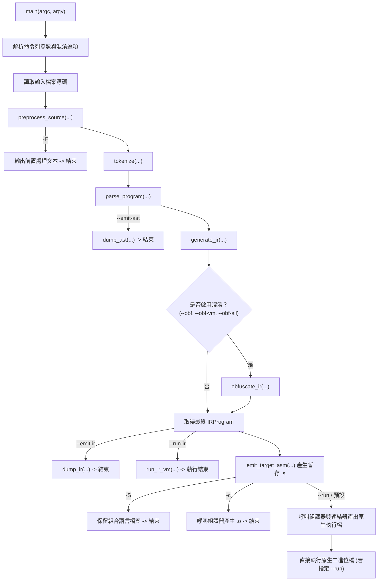

# 第 1 章：為什麼從零寫一個跨平台 C 編譯器？

> 「若你無法從零打造一個工具，你就永遠無法真正理解它的極限與漏洞。」

在現代軟體工程中，編譯器往往被視為極度龐大、深不可測的黑盒子。以工業級標準 LLVM/Clang 或 GCC 而言，動輒數百萬行 C++ 原始碼、龐雜的相依套件與複雜的建置系統，往往讓想深入探索「C 語言到底如何變成機器碼」以及「二進位程式碼如何防範反組譯逆向」的工程師望而卻步。

本書的核心專案 **XCC**（Cross-Platform C Compiler）採取了一條截然不同的路徑：**使用純 C11、零外部相依套件，以不到一萬行的精簡代碼，從零實作一個具備跨平台原生程式碼生成、IR 虛擬機以及高強度反逆向保護能力的 C 編譯器**。

在本章中，我們將拆解 C 編譯器的全生命週期，建立全書的整體架構觀，並探討跨平台目標矩陣（Target Matrix）與編譯器驅動器（Driver）的設計。

---

## 1.1 編譯器黑盒子拆解：從原始碼到機器碼

當我們在終端機輸入 `cc main.c -o app` 時，背後其實經歷了一連串緊密串聯的子系統轉換：

```mermaid
flowchart LR
    SRC["C 原始碼 (.c/.h)"] --> PP["前置處理器 (Preprocessor)"]
    PP --> LEX["詞法分析 (Lexer)"]
    LEX --> PARSE["語法分析 (Parser) & 型別系統"]
    PARSE --> AST["抽象語法樹 (AST)"]
    AST --> IRGEN["中間表示產生 (IR Lowering)"]
    IRGEN --> IR["三址碼 (TAC IR)"]
    IR --> OBF["Custom IR 混淆與 VM 虛擬化"]
    OBF --> CODEGEN["目標架構代碼生成 (Codegen)"]
    CODEGEN --> ASM["組合語言 (.s)"]
    ASM --> SYSASM["系統組譯與連結器 (as / ld)"]
    SYSASM --> BIN["原生執行檔 (Mach-O / ELF / PE)"]
```



1. **前置處理（Preprocessing）**：
   展開 `#include` 檔案、代換 `#define` 巨集、處理 `#if` / `#ifdef` 條件編譯，並過濾原始碼中的註解。輸出一段純淨的 C 語言字串。
2. **詞法分析（Lexing / Scanning）**：
   將文字流切分為有意義的語彙單元（Tokens），例如關鍵字 `if`、識別字 `foo`、運算子 `+`、數值字面量 `123`，同時記錄每個 Token 的行列號。
3. **語法分析與型別推導（Parsing & Type Checking）**：
   根據 C 語言文法，將 Token 流構建成樹狀結構——**抽象語法樹（AST）**。在此階段進行作用域查找（Scope Lookup）、型別檢查與指標算術縮放（Pointer Arithmetic Scaling）。
4. **中間表示降階（IR Lowering）**：
   將樹狀的 AST 攤平為線性、平台無關的**三址碼（Three-Address Code IR）**。這一步是現代編譯器的核心解耦點：前端只需專注於語法解析，後端只需專注於指令選取。
5. **程式碼保護與強化（Custom Hardened IR & Virtualization）**：
   在平台無關的 IR 層進行防破解操作，包括控制流平坦化（CFF）、數論不透明謂詞（BCF）、混合布林算術（MBA）、字串動態加密，甚至將關鍵邏輯編譯成特製 Bytecode 並嵌入多態自校驗虛擬機。
6. **原生代碼生成（Native Code Generation）**：
   遍歷 IR，將虛擬暫存器映射至目標架構的硬體暫存器與堆疊框，輸出符合特定作業系統 ABI（呼叫慣例）的組合語言（ARM64 / x86_64）。
7. **組譯與連結（Assembling & Linking）**：
   藉由宿主機的組譯器與連結器，將組合語言轉換為機器碼目標檔（`.o`）並連結 C 標準程式庫（`libc`），最終生成可執行的二進位檔案。

---

## 1.2 XCC 架構設計哲學：簡約、純粹與模組化

為了讓編譯器的每一行代碼都具備最高的教育價值與實戰透明度，XCC 遵循以下三大核心原則：

* **純 C11 實作，零外部依賴**：不依賴 Flex/Bison、不依賴 LLVM，只使用標準 C 程式庫（`<stdio.h>`, `<stdlib.h>`, `<string.h>`）。只要有一台裝有 C 編譯器的電腦，就能在幾秒內編譯出 XCC。
* **單一標頭檔契約（Single-Header Contract）**：
  專案中所有核心資料結構（Token、AST、Type、IR、Target）全部統一定義於 [`include/xcc.h`](file:///Users/hcwtony/repo/projects/ccompiler/include/xcc.h)。每個模組各自實作對應的 `.c` 檔，職責分明且介面透明：
  * [`src/main.c`](file:///Users/hcwtony/repo/projects/ccompiler/src/main.c)：命令列解析與編譯流程驅動
  * [`src/type.c`](file:///Users/hcwtony/repo/projects/ccompiler/src/type.c)：目標平台定義與型別系統
  * [`src/preprocessor.c`](file:///Users/hcwtony/repo/projects/ccompiler/src/preprocessor.c)：前置處理器與內建虛擬標準標頭
  * [`src/lexer.c`](file:///Users/hcwtony/repo/projects/ccompiler/src/lexer.c)：詞法分析器
  * [`src/parser.c`](file:///Users/hcwtony/repo/projects/ccompiler/src/parser.c)：遞迴下降剖析器與符號表
  * [`src/ir.c`](file:///Users/hcwtony/repo/projects/ccompiler/src/ir.c)：三址碼生成與 AST 降階
  * [`src/vm.c`](file:///Users/hcwtony/repo/projects/ccompiler/src/vm.c)：跨平台 IR 虛擬機
  * [`src/codegen_arm64.c`](file:///Users/hcwtony/repo/projects/ccompiler/src/codegen_arm64.c)：ARM64 原生後端
  * [`src/codegen_x86_64.c`](file:///Users/hcwtony/repo/projects/ccompiler/src/codegen_x86_64.c)：x86_64 原生後端
  * [`src/ir_obf.c`](file:///Users/hcwtony/repo/projects/ccompiler/src/ir_obf.c)：Custom IR 混淆與多態虛擬機
* **多目標原生支援（Multi-Target Out of the Box）**：
  XCC 在編譯時就內建了所有支援架構的代碼生成器。即使你在 Apple Silicon Mac（ARM64 macOS）上執行 XCC，也可以直接交叉編譯出 x86_64 Linux 或 Windows 的組合語言與目標檔。

---

## 1.3 跨平台目標矩陣（Target Matrix）的設計

實作跨平台編譯器時，許多初學者常犯的錯誤是將平台特性硬編碼（Hardcode）在程式碼生成邏輯中。XCC 透過結構化的目標矩陣解決此問題。

在 [`include/xcc.h`](file:///Users/hcwtony/repo/projects/ccompiler/include/xcc.h#L13-L36) 中，我們定義了支援的目標平台列舉與屬性描述體：

```c
typedef enum {
    TARGET_ARM64_MACOS,
    TARGET_ARM64_LINUX,
    TARGET_X86_64_MACOS,
    TARGET_X86_64_LINUX,
    TARGET_X86_64_WINDOWS,
} TargetPlatform;

typedef struct {
    TargetPlatform platform;
    const char *name;          /* 例如: "arm64-macos", "x86_64-linux" */
    const char *triple;        /* 例如: "arm64-apple-darwin", "x86_64-unknown-linux-gnu" */
    bool is_macos;
    bool is_linux;
    bool is_windows;
    bool is_arm64;
    bool is_x86_64;
    const char *symbol_prefix; /* macOS Mach-O 需要前綴 "_"，Linux/Windows 為 "" */
} TargetInfo;
```

而在 [`src/type.c`](file:///Users/hcwtony/repo/projects/ccompiler/src/type.c#L11-L60) 中，我們建立了靜態註冊表：

```c
static const TargetInfo k_targets[] = {
    {
        .platform = TARGET_ARM64_MACOS,
        .name = "arm64-macos",
        .triple = "arm64-apple-darwin",
        .is_macos = true, .is_linux = false, .is_windows = false,
        .is_arm64 = true, .is_x86_64 = false,
        .symbol_prefix = "_",
    },
    {
        .platform = TARGET_ARM64_LINUX,
        .name = "arm64-linux",
        .triple = "aarch64-unknown-linux-gnu",
        .is_macos = false, .is_linux = true, .is_windows = false,
        .is_arm64 = true, .is_x86_64 = false,
        .symbol_prefix = "",
    },
    {
        .platform = TARGET_X86_64_MACOS,
        .name = "x86_64-macos",
        .triple = "x86_64-apple-darwin",
        .is_macos = true, .is_linux = false, .is_windows = false,
        .is_arm64 = false, .is_x86_64 = true,
        .symbol_prefix = "_",
    },
    {
        .platform = TARGET_X86_64_LINUX,
        .name = "x86_64-linux",
        .triple = "x86_64-unknown-linux-gnu",
        .is_macos = false, .is_linux = true, .is_windows = false,
        .is_arm64 = false, .is_x86_64 = true,
        .symbol_prefix = "",
    },
    {
        .platform = TARGET_X86_64_WINDOWS,
        .name = "x86_64-windows",
        .triple = "x86_64-w64-mingw32",
        .is_macos = false, .is_linux = false, .is_windows = true,
        .is_arm64 = false, .is_x86_64 = true,
        .symbol_prefix = "",
    },
};
```

### 宿主機自適應偵測（Host Auto-Detection）
為了提供最順暢的使用者體驗，編譯器在預設情況下應自動編譯出相容於當前主機的程式碼。我們利用 C 預先定義巨集（Predefined Macros）在編譯期偵測宿主機：

```c
TargetPlatform get_host_target(void) {
#if defined(__APPLE__) && defined(__aarch64__)
    return TARGET_ARM64_MACOS;
#elif defined(__APPLE__) && defined(__x86_64__)
    return TARGET_X86_64_MACOS;
#elif defined(__linux__) && defined(__aarch64__)
    return TARGET_ARM64_LINUX;
#elif defined(__linux__) && defined(__x86_64__)
    return TARGET_X86_64_LINUX;
#elif defined(_WIN32) && defined(_M_X64)
    return TARGET_X86_64_WINDOWS;
#else
    return TARGET_ARM64_MACOS; // 預設後備
#endif
}
```

如此一來，使用者只需執行 `./xcc app.c`，驅動程式便會自動挑選合適的 ABI 與組合語言發射器。

---

## 1.4 編譯器驅動器（Driver）的設計與實作

編譯器的核心管線通常需要支援不同的「中途停靠站」（Pipelines），以方便工程師觀察與除錯。在 [`src/main.c`](file:///Users/hcwtony/repo/projects/ccompiler/src/main.c) 中，我們規劃了完整的管線分流：



### 命令列參數設計
在 [`src/main.c`](file:///Users/hcwtony/repo/projects/ccompiler/src/main.c#L87-L135) 中，我們支援了標準 GCC/Clang 風格的參數以及專屬的保護選項：
* `-E`：僅執行前置處理器並將結果輸出到標準輸出或檔案。
* `--emit-ast`：印出語法解析後的抽象語法樹結構。
* `--emit-ir`：印出平台無關的線性三址碼（若啟用混淆則會印出強化後的 Custom IR）。
* `--run-ir`：直接使用 XCC 內建的 IR 虛擬機在記憶體中執行，不需透過外部組譯器與連結器。
* `-S`：編譯為目標架構的組合語言文字檔（`.s`）。
* `-c`：編譯並組譯為目標檔（`.o`）。
* `--run`：編譯成原生二進位檔後立即載入執行並回傳退出代碼。
* `--obf-all`：啟用雙軌最高強度防逆向保護（Custom IR 混淆 + 內嵌多態自校驗 Bytecode VM）。

---

## 1.5 實作環境準備與初次編譯

在開始實作各個模組之前，讓我們先檢視本專案的 [`Makefile`](file:///Users/hcwtony/repo/projects/ccompiler/Makefile)：

```makefile
CC      ?= cc
CFLAGS  ?= -std=c11 -O2 -Wall -Wextra -Iinclude

SRCS    := src/main.c \
           src/type.c \
           src/preprocessor.c \
           src/lexer.c \
           src/parser.c \
           src/ir.c \
           src/ir_obf.c \
           src/vm.c \
           src/codegen_arm64.c \
           src/codegen_x86_64.c

OBJS    := $(SRCS:.c=.o)
TARGET  := xcc

all: $(TARGET)

$(TARGET): $(OBJS)
	$(CC) $(CFLAGS) -o $@ $(OBJS)

src/%.o: src/%.c include/xcc.h
	$(CC) $(CFLAGS) -c $< -o $@

test: $(TARGET)
	./tests/run_tests.sh

clean:
	rm -f $(OBJS) $(TARGET)
```

只要輸入 `make`，便能完成編譯並生成名為 `xcc` 的單一執行檔。

---

## 1.6 小結

在本章中，我們掌握了：
1. 編譯器內部從前端（Preprocessor、Lexer、Parser）到中端（TAC IR）再到後端（Native Codegen）的完整流通途徑。
2. XCC 專案堅持的純 C11、單一標頭檔介面與零依賴設計理念。
3. 如何利用統一的 `TargetInfo` 結構管理跨架構（ARM64/x86_64）與跨系統（macOS/Linux/Windows）的編譯細節。
4. 編譯器驅動器（Driver）如何支援彈性的中途觀察管線（`-E`, `--emit-ast`, `--emit-ir`, `--run-ir`, `-S`）。

在下一章中，我們將直接面對跨平台編譯的第一個重大挑戰：**如何打造一個具備自帶標準標頭檔、支援巨集與條件編譯的零依賴前置處理器**。
