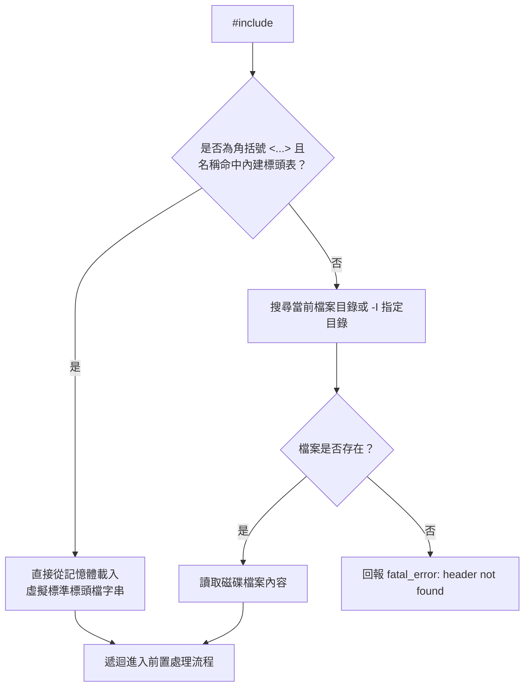

# 第 2 章：零依賴 C 前置處理器與內建跨平台標頭檔

> 「編譯器的第一個戰場，不是 AST，不是暫存器分配，而是前置處理器面對的字串泥淖。」

在實作 C 編譯器時，許多開發者在實作完基礎的語法分析後，滿懷熱血地寫下了 `#include <stdio.h>`，編譯器卻在下一秒噴出成千上萬行語法錯誤而宣告陣亡。

這背後的原因是：**現代作業系統（如 macOS、glibc、MSVC）的系統標頭檔充斥著大量的編譯器專屬擴充（Compiler Extensions）**——例如 GCC/Clang 的 `__attribute__((...))`、`__asm__(...)`、`__builtin_va_list`，或者複雜如迷宮般的巢狀巨集條件編譯。若編譯器試圖直接吃下主機系統的 `<stdio.h>`，就必須先實作完整的 GNU C/Apple C 擴充方言，這對於一個輕量級編譯器而言無疑是本末倒置。

在本章中，我們將探討 XCC 如何透過**虛擬內建標準標頭檔（Virtual Built-in Headers）**實現乾淨、高相容的跨平台編譯，並深入實作巨集定義（`#define`）、參數替換、字串化（`#`）、條件編譯（`#if` / `#ifdef` / `#else`）與引入保護（`#pragma once`）。

---

## 2.1 跨平台編譯的第一道高牆：系統標頭檔陷阱

當你在 macOS 上打開 `/Library/Developer/CommandLineTools/SDKs/MacOSX.sdk/usr/include/stdio.h`，你會發現它的第一行並不是 `int printf(const char *fmt, ...);`，而是數百行涉及架構檢測、POSIX 規範版本判定、以及 Apple 專屬簽章屬性的複雜宏定義。

如果我們的目標是建立一個具備移植性、能在 ARM64 Linux、macOS 與 Windows 間自由交叉編譯的獨立編譯器，最好的策略便是：**在編譯器內部自帶一套標準 C 庫宣告！**

XCC 在前置處理器中實作了攔截機制：當遇到 `#include <stddef.h>` 或 `#include <stdio.h>` 這類標準庫請求時，優先從編譯器內建的記憶體靜態表查找；若找不到（或是 `#include "my_header.h"`），再退回到本機檔案系統搜尋。



---

## 2.2 虛擬內建標準標頭檔（Virtual Built-in Headers）實作

在 [`src/preprocessor.c`](file:///Users/hcwtony/repo/projects/ccompiler/src/preprocessor.c#L11-L155) 中，我們定義了 `BuiltinHeader` 陣列，為常用的 C 標準函式庫提供純淨、規範化的型別與函式宣告：

```c
typedef struct {
    const char *name;
    const char *content;
} BuiltinHeader;

static const BuiltinHeader k_builtin_headers[] = {
    {
        "stddef.h",
        "#ifndef _XCC_STDDEF_H\n"
        "#define _XCC_STDDEF_H\n"
        "#define NULL ((void*)0)\n"
        "typedef unsigned long size_t;\n"
        "typedef long ptrdiff_t;\n"
        "#endif\n"
    },
    {
        "stdbool.h",
        "#ifndef _XCC_STDBOOL_H\n"
        "#define _XCC_STDBOOL_H\n"
        "#define bool _Bool\n"
        "#define true 1\n"
        "#define false 0\n"
        "#endif\n"
    },
    {
        "stdint.h",
        "#ifndef _XCC_STDINT_H\n"
        "#define _XCC_STDINT_H\n"
        "typedef char int8_t;\n"
        "typedef unsigned char uint8_t;\n"
        "typedef short int16_t;\n"
        "typedef unsigned short uint16_t;\n"
        "typedef int int32_t;\n"
        "typedef unsigned int uint32_t;\n"
        "typedef long int64_t;\n"
        "typedef unsigned long uint64_t;\n"
        "typedef long intptr_t;\n"
        "typedef unsigned long uintptr_t;\n"
        "#endif\n"
    },
    {
        "stdio.h",
        "#ifndef _XCC_STDIO_H\n"
        "#define _XCC_STDIO_H\n"
        "#include <stddef.h>\n"
        "#define EOF (-1)\n"
        "#define SEEK_SET 0\n"
        "#define SEEK_CUR 1\n"
        "#define SEEK_END 2\n"
        "typedef struct _FILE FILE;\n"
        "int printf(const char *fmt, ...);\n"
        "int fprintf(FILE *stream, const char *fmt, ...);\n"
        "int sprintf(char *str, const char *fmt, ...);\n"
        "int snprintf(char *str, size_t size, const char *fmt, ...);\n"
        "int scanf(const char *fmt, ...);\n"
        "int puts(const char *s);\n"
        "int putchar(int c);\n"
        "int getchar(void);\n"
        "FILE *fopen(const char *path, const char *mode);\n"
        "int fclose(FILE *stream);\n"
        "size_t fread(void *ptr, size_t size, size_t nmemb, FILE *stream);\n"
        "size_t fwrite(const void *ptr, size_t size, size_t nmemb, FILE *stream);\n"
        "#endif\n"
    },
    // ... 包含 stdlib.h, string.h, ctype.h, assert.h 等
};
```

這個設計帶來了巨大的優勢：
1. **編譯器執行檔自給自足**：無論使用者在什麼作業系統上執行 XCC，都不會因為找不到本機 SDK 標頭檔而失敗。
2. **零 ABI 污染**：所有型別大小（如 64 位元系統上的 `size_t` 為 8 位元組）完全由編譯器精確掌控，不會混入 GCC/Clang 專屬巨集。

---

## 2.3 巨集符號表與 `#define` / `#undef` 實作

前置處理器的第二個核心任務是管理巨集。巨集可分為兩大類：
1. **物件式巨集（Object-like Macro）**：例如 `#define BUFFER_SIZE 1024`
2. **函數式巨集（Function-like Macro）**：例如 `#define MAX(a, b) ((a) > (b) ? (a) : (b))`

在 [`src/preprocessor.c`](file:///Users/hcwtony/repo/projects/ccompiler/src/preprocessor.c#L210-L265) 中，我們設計了巨集結構體與符號表：

```c
typedef struct Macro {
    char *name;
    bool is_func;
    int param_count;
    char **params;
    char *body;
    struct Macro *next;
} Macro;

typedef struct {
    Macro *macros;
    const PreprocessorConfig *cfg;
    char *once_files[256];
    int once_count;
} PPContext;
```

### 巨集定義與展開流程
* **解析 `#define`**：
  若識別字後方緊接左括號 `(`（中間無空白），則標記為函數式巨集，並解析參數名稱清單；否則為純文字替換的物件式巨集。
* **字串化運算子 `#`**：
  在函數式巨集展開時，若參數前帶有 `#` 符號（如 `#define STR(x) #x`），前置處理器會將該引數的值以雙引號括起，並將內部的雙引號與反斜線自動加上跳脫字元轉成標準 C 字串字面量。
* **防範無窮遞迴展開**：
  當巨集 A 的本體中再次出現巨集 A 時，標準 C 規範要求不得再次自我展開。我們在前置處理掃描字詞時維持一個活躍展開標記集合，防止堆疊溢位。

---

## 2.4 條件編譯：`#if`、`#ifdef`、`#elif`、`#else`

條件編譯允許程式碼依據特定旗標選擇性編譯。在跨平台專案中，這是最不可或缺的機制。

### 條件狀態堆疊（Conditional State Stack）
在掃描原始碼時，條件編譯可能是深層巢狀的：
```c
#ifdef _WIN32
    #if DEBUG_LEVEL > 1
        // Windows Debug Code
    #endif
#else
    // POSIX Code
#endif
```

為了正確追蹤目前的程式碼區塊是否應該被輸出，我們在掃描器中使用條件堆疊：
```c
typedef struct CondStack {
    bool parent_active; // 外層區塊是否有效
    bool condition_met; // 本層當前分支條件是否成立
    bool branch_taken;  // 本層是否已有任一 if/elif 分支成立過
    struct CondStack *prev;
} CondStack;
```

每當遇到 `#if` 或 `#ifdef` 時，壓入一個新的 `CondStack`；遇到 `#elif` 時，若先前已有分支成立過（`branch_taken == true`），則直接將當前狀態視為忽略；遇到 `#endif` 則彈出堆疊。

### `#if` 常數表達式求值（Constant Expression Evaluator）
`#if` 的條件不僅僅是布林值，它允許運算式與 `defined(NAME)` 語法，例如：
```c
#if defined(__APPLE__) && (VERSION >= 2)
```
前置處理器內建了一個小型的整數算術求值器：
1. 將所有 `defined(X)` 運算子先評估為 `1` 或 `0`。
2. 將所有未被定義的識別字視為整數 `0`。
3. 按照標準算術運算子優先級（加減乘除、比較、邏輯運算）計算出最終整數結果；若大於 0 則條件成立。

---

## 2.5 預防重複引入：`#pragma once` 與 Include Guards

大型專案常會有多個 `.c` 檔案間接引入相同的標頭檔。如果沒有保護機制，型別重複定義的錯誤將層出不窮。

XCC 同時支援傳統的 Header Guard（`#ifndef _HEADER_H`）與現代主流的 `#pragma once`：
1. 當前置處理器在檔案中掃描到 `#pragma once` 指令時，提取當前檔案的絕對路徑（Canonical Path）。
2. 將該檔案路徑記錄到 `PPContext.once_files` 清單中。
3. 下次再遇到 `#include` 請求該檔案時，直接跳過檔案讀取，大幅加速編譯速度。

---

## 2.6 動手實測：驗證前置處理器

現在讓我們建立一個測試檔 `test_pp.c`，檢視 XCC 的 `-E` 參數輸出：

```c
#include <stdio.h>
#define PI 3
#define SQUARE(x) ((x) * (x))
#define TO_STR(s) #s

int main(void) {
#if PI > 2
    printf("Result: %d, Str: %s\n", SQUARE(5), TO_STR(Hello XCC));
#else
    printf("Disabled\n");
#endif
    return 0;
}
```

執行命令：
```bash
./xcc -E test_pp.c
```

你將看到輸出中內嵌的 `<stdio.h>` 精簡宣告、`PI` 與 `SQUARE(5)` 被展開為 `((5) * (5))`、字串化結果 `"Hello XCC"`，且 `#if` 區塊外的無效分支已被乾淨地剔除！

---

## 2.7 小結

在本章中，我們掌握了：
1. 現代系統標頭檔的相容性陷阱，以及虛擬標準標頭檔（Virtual Built-in Headers）如何賦予編譯器強大的跨平台自持能力。
2. 巨集系統的定義、查找、函數式引數替換與字串化運算子 `#`。
3. 巢狀條件編譯狀態堆疊（`#if` / `#ifdef` / `#elif` / `#endif`）與 `defined()` 常數表達式求值器。
4. `#pragma once` 檔案快取防重複機制。

在具備了純淨的前置處理字串之後，下一章我們將進入編譯器的第二道管線：**詞法分析器（Lexer）與原始碼位置診斷系統**。
