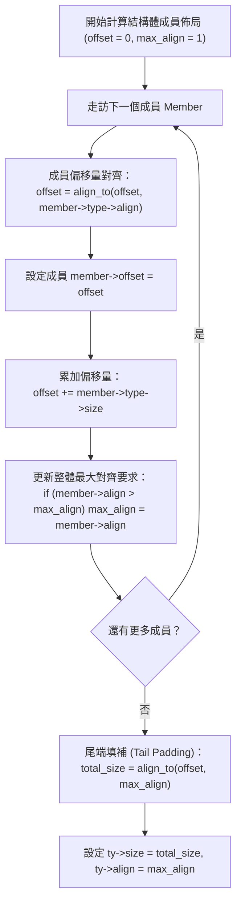

# 第 4 章：C 語言型別系統與記憶體對齊模型

> 「在 C 語言中，型別並非抽象的數學概念，而是記憶體位元組的幾何學與硬體匯流排的物理約束。」

許多高階語言（如 Python、JavaScript）將型別抽象化為物件標籤，開發者鮮少需要考慮資料在記憶體中究竟佔據幾個位元組、是否需要填補空白位元組（Padding）。

但在系統程式設計與編譯器工程中，**型別系統（Type System）直接決定了 CPU 指令的挑選、暫存器寬度（32-bit vs. 64-bit）、指標加減運算的位移縮放，以及結構體在記憶體中的二進位排佈**。若型別推導或記憶體對齊（Alignment）稍有差池，輕則觸發效能低落的跨邊界記憶體存取，重則在 ARM64 等架構上直接引發硬體例外（Alignment Fault / SIGBUS）。

在本章中，我們將深入剖析 XCC 如何在 [`include/xcc.h`](file:///Users/hcwtony/repo/projects/ccompiler/include/xcc.h) 與 [`src/type.c`](file:///Users/hcwtony/repo/projects/ccompiler/src/type.c) 中建立精確的 C11 型別模型，並實作結構體（`struct`）與聯合體（`union`）的記憶體對齊計算演算法。

---

## 4.1 型別表示法：`Type` 核心資料結構

在 XCC 中，所有型別（包括純量、陣列、指標、結構體、函式）統一由一個結構體 [`Type`](file:///Users/hcwtony/repo/projects/ccompiler/include/xcc.h#L193-L230) 描述：

```c
typedef enum {
    TY_VOID,
    TY_BOOL,
    TY_CHAR,
    TY_SHORT,
    TY_INT,
    TY_LONG,
    TY_ENUM,
    TY_PTR,
    TY_ARRAY,
    TY_STRUCT,
    TY_UNION,
    TY_FUNC,
} TypeKind;

struct Type {
    TypeKind kind;
    int size;             /* 佔據的記憶體位元組大小 (sizeof) */
    int align;            /* 記憶體對齊要求 (_Alignof) */
    bool is_unsigned;     /* 是否為無號數 */

    /* 衍生型別：指標或陣列的基底型別 */
    Type *base;
    int array_len;        /* 陣列長度 (例如 int[10] 為 10) */

    /* 結構體與聯合體 */
    char *tag;            /* struct/union 標籤名稱 */
    Member *members;      /* 成員鏈結串列 */
    bool is_complete;     /* 是否為完整型別 (區分前置宣告 struct Foo;) */

    /* 函式型別 */
    Type *return_type;    /* 回傳值型別 */
    Param *params;        /* 參數清單 */
    int param_count;
    bool is_variadic;     /* 是否為可變參數函式 (如 printf) */
};
```

### 內建基礎型別單例（Singletons）
在 64 位元體系（LP64 模型：Linux/macOS/Windows x86_64 與 ARM64）中，基礎資料型別的大小與對齊如下表所示：

| 型別名稱 | `TypeKind` | 位元組大小 (`size`) | 對齊邊界 (`align`) | 有無號數 (`is_unsigned`) |
| :--- | :--- | :---: | :---: | :---: |
| `void` | `TY_VOID` | 1 | 1 | `false` |
| `bool` / `_Bool` | `TY_BOOL` | 1 | 1 | `true` |
| `char` | `TY_CHAR` | 1 | 1 | `false` |
| `unsigned char` | `TY_CHAR` | 1 | 1 | `true` |
| `short` | `TY_SHORT` | 2 | 2 | `false` |
| `unsigned short` | `TY_SHORT` | 2 | 2 | `true` |
| `int` | `TY_INT` | 4 | 4 | `false` |
| `unsigned int` | `TY_INT` | 4 | 4 | `true` |
| `long` | `TY_LONG` | 8 | 8 | `false` |
| `unsigned long` | `TY_LONG` | 8 | 8 | `true` |
| 指標 (`T*`) | `TY_PTR` | 8 | 8 | `true` |

在 [`src/type.c`](file:///Users/hcwtony/repo/projects/ccompiler/src/type.c#L175-L196) 中，我們預先建立了這些不可變的全域單例指標（如 `ty_int`, `ty_char`, `ty_ulong`），當語法分析器解析到基本型別時，可以直接複用指標，大幅節省記憶體並加快指標比對速度。

---

## 4.2 衍生型別建構：指標、陣列與函式

當型別涉及修飾時，型別系統透過遞迴指標 `base` 形成一棵「型別構造樹」：

### 1. 指標型別（Pointer Type）
指標本質上是一個 64 位元的無號記憶體位址，但它必須記住它所指向的目標型別 `base`，以便後續進行解引用（`*ptr`）與指標算術縮放：
```c
Type *pointer_to(Type *base) {
    Type *ty = new_type(TY_PTR, 8, 8);
    ty->base = base;
    ty->is_unsigned = true;
    return ty;
}
```

### 2. 陣列型別（Array Type）
陣列在記憶體中是連續緊鄰的資料塊，其總大小為元素大小乘以長度，對齊邊界則與基底型別相同：
```c
Type *array_of(Type *base, int len) {
    Type *ty = new_type(TY_ARRAY, base->size * len, base->align);
    ty->base = base;
    ty->array_len = len;
    return ty;
}
```
> [!NOTE]
> 多維陣列如 `int a[3][5]` 在 XCC 中被表示為：一個長度為 3 的陣列，其 `base` 為長度為 5 的 `int` 陣列。這種階層式結構讓多維陣列的位址計算變得極為自然。

---

## 4.3 記憶體對齊幾何學：結構體與聯合體的成員佈局

硬體 CPU 存取記憶體時，通常以 4 位元組或 8 位元組為單位（Words/Doublewords）。若一個 4 位元組的 `int` 放在非 4 倍數的記憶體位址上，CPU 必須進行兩次記憶體讀取並拼裝位元組，導致顯著的效能損失。因此，C 語言規範嚴格定義了記憶體對齊規則。

### 對齊公式（Alignment Math）
要將偏移量 $N$ 對齊到 $A$（$A$ 必須是 2 的次方），其位元運算公式為：
$$\text{align\_to}(N, A) = (N + A - 1) \ \& \ \sim(A - 1)$$

在 XCC 的 [`src/type.c`](file:///Users/hcwtony/repo/projects/ccompiler/src/type.c) 與 [`src/parser.c`](file:///Users/hcwtony/repo/projects/ccompiler/src/parser.c#L490-L515) 中，結構體成員佈局演算法如下：



### 實例拆解：結構體的記憶體填補（Padding）
考慮以下結構體定義：
```c
struct Example {
    char a;    // size: 1, align: 1
    int b;     // size: 4, align: 4
    short c;   // size: 2, align: 2
};
```
如果沒有對齊規則，這三個欄位緊貼在一起只需 $1 + 4 + 2 = 7$ 個位元組。但在 XCC 的編譯運算下：
1. `offset = 0`：放入 `char a`，佔據 byte 0。目前 `offset = 1`。
2. 放入 `int b`：`b` 的對齊為 4。目前 `offset` 為 1，需對齊到 4 的倍數，因此在 byte 1, 2, 3 插入 **3 位元組的填補（Padding）**。`b` 的偏移量為 4，佔據 byte 4–7。目前 `offset = 8`。
3. 放入 `short c`：`c` 的對齊為 2。目前 `offset` 為 8（已是 2 的倍數），因此 `c` 放在 byte 8–9。目前 `offset = 10`。
4. **尾端填補（Tail Padding）**：整個結構體中最大的成員對齊是 `int b` 的 4，因此整體結構體對齊 `max_align = 4`。最終大小必須是 4 的倍數：`align_to(10, 4) = 12`。因此在 byte 10, 11 補上 **2 位元組的尾端填補**。

最終 `sizeof(struct Example)` 為 **12**，確保此結構體若宣告為陣列時，每一個陣列元素的每個欄位都能落在合法對齊的邊界上。

### 聯合體（`union`）的記憶體佈局
聯合體的所有成員共享同一個起始記憶體位址（`offset = 0`）：
* 聯合體的大小為：**所有成員中最大成員的大小，向上對齊到最大對齊邊界**。
* `ty->size = align_to(max_size, max_align)`。

---

## 4.4 型別相容性與共同型別推導（Common Type）

在 C 語言的二元運算式（如 `x + y` 或 `cond ? a : b`）中，若兩邊運算元型別不同，編譯器必須進行**算術常規轉換（Usual Arithmetic Conversions）**。

在 [`src/type.c`](file:///Users/hcwtony/repo/projects/ccompiler/src/type.c#L247-L261) 中，我們實作了 `common_type` 函式：

```c
Type *common_type(Type *t1, Type *t2) {
    if (!t1) return t2;
    if (!t2) return t1;

    // 1. 若任一方為指標，結果提升為指標型別
    if (t1->base) return pointer_to(t1->base);
    if (t2->base) return pointer_to(t2->base);

    // 2. 整數提升 (Integer Promotion)：小於 4 位元組 (char, short) 先提升為 4 位元組 (int)
    int s1 = t1->size < 4 ? 4 : t1->size;
    int s2 = t2->size < 4 ? 4 : t2->size;

    // 3. 寬度優先：以較大位元組者為主 (例如 int 與 long 運算 -> long)
    if (s1 != s2) {
        return (s1 < s2) ? t2 : t1;
    }

    // 4. 無號優先：若大小相同，任一方為 unsigned 則結果為 unsigned
    if (t1->is_unsigned || t2->is_unsigned) {
        return (s1 == 8) ? ty_ulong : ty_uint;
    }
    return (s1 == 8) ? ty_long : ty_int;
}
```

這個函式簡潔地涵蓋了 C 語言規範中最核心的運算元型別提升規則，並直接指引了後續程式碼生成器應發射 32 位元還是 64 位元的算術指令。

---

## 4.5 小結

在本章中，我們掌握了：
1. XCC 如何使用單一 `Type` 結構完整表達純量、指標、陣列、結構體、聯合體與函式型別。
2. 64 位元架構下的型別幾何約束與記憶體對齊位元運算公式。
3. 結構體成員偏移量遞增與尾端填補（Tail Padding）的完整計算流程。
4. 算術運算式的共同型別（`common_type`）推導與整數提升原則。

有了型別系統的基石，在下一章中，我們將進入語法分析器的上半部：**遞迴下降分析、雙命名空間符號表與複雜的 C 宣告語法**。
