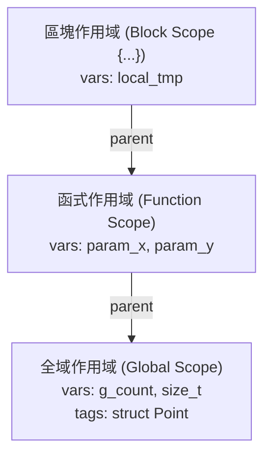

# 第 5 章：遞迴下降語法分析（上）——宣告、作用域與結構體

> 「C 語言的宣告語法，是整個電腦語言發展史上最令人著迷、也最容易讓編譯器開發者精神崩潰的設計之一。」

如果你曾經看過類似 `int (*(*fp)(int))[10];` 這樣的宣告並感到一頭霧水，請放心，你絕不是唯一的一個。C 語言的宣告哲學是「Declaration mimics use」（宣告仿照使用）：當你宣告一個指標時寫 `*p`，是因為你在表達式中取值也是寫 `*p`。

然而，這種設計打破了許多現代語言「型別在左、變數在右」的直觀規律，將前置修飾（`*`）、後置修飾（`[10]`、`()`）以及括號優先級交織在一起。

在本章中，我們將跨入編譯器的語法分析核心（Parser）。我們將探討如何用乾淨的**遞迴下降（Recursive Descent）演算法**，拆解 C 語言的宣告說明符（Declspec）與宣告符（Declarator），實作支援區塊巢狀與雙命名空間（Dual Namespaces）的作用域符號表，並完成結構體與全域常數初始化串列的解析。

---

## 5.1 雙命名空間作用域管理（Dual Namespaces Scope）

在進入宣告剖析之前，編譯器必須先有能力「記住」目前可見的變數與型別。

C 語言標準規範了一個非常特殊的規則：**識別字與標籤分屬不同的命名空間（Namespaces）**！
這意味著以下代碼在標準 C 中完全合法且互不衝突：
```c
struct Point { int x, y; };
int Point = 42; // 合法！一個是 struct 標籤，一個是普通變數名
```

在 [`src/parser.c`](file:///Users/hcwtony/repo/projects/ccompiler/src/parser.c#L10-L100) 中，我們設計了巢狀樹狀作用域結構：

```c
typedef struct VarScope VarScope;
struct VarScope {
    char *name;           /* 識別字名稱 */
    VarObj *var;          /* 變數物件指標 (區域變數或全域變數) */
    Type *type_def;       /* typedef 定義的型別 (若為 typedef 名稱) */
    Type *enum_ty;        /* 所屬列舉型別 */
    int64_t enum_val;     /* 列舉常數數值 */
    VarScope *next;
};

typedef struct TagScope TagScope;
struct TagScope {
    char *name;           /* struct / union / enum 標籤名稱 */
    Type *type;           /* 對應的型別定義 */
    TagScope *next;
};

typedef struct Scope Scope;
struct Scope {
    VarScope *vars;       /* 一般變數、typedef、enum 常數符號表 */
    TagScope *tags;       /* struct / union / enum 標籤符號表 */
    Scope *parent;        /* 外層父作用域 (往外追溯) */
};
```



### 作用域進入與退出
* `enter_scope(Parser *p)`：當進入函式體或大括號 `{...}` 複合陳述時，配置一個新的 `Scope` 並將 `parent` 指向當前作用域。
* `leave_scope(Parser *p)`：當離開區塊時，`p->scope = p->scope->parent`，區塊內部宣告的區域變數自然隱藏，但堆疊位址與 AST 節點依然保留。
* `find_var(Parser *p, const char *name)`：沿著 `parent` 指標由內向外搜尋變數或 `typedef`。這天然支援了 C 語言的**變數遮蔽（Shadowing）**特性。

---

## 5.2 宣告剖析（一）：宣告說明符（Declaration Specifiers）

一個標準 C 語言宣告通常由兩部分組成：
$$\text{Declaration} = \text{DeclSpec} + \text{Declarator}$$
例如在 `static unsigned long *ptr[10];` 中：
* `static unsigned long` 是 **DeclSpec（說明符）**。
* `*ptr[10]` 是 **Declarator（宣告符）**。

在 [`src/parser.c`](file:///Users/hcwtony/repo/projects/ccompiler/src/parser.c#L560-L646) 中，`parse_declspec` 負責掃描並歸納型別特徵與儲存類別：

```c
static Type *parse_declspec(Parser *p, bool *is_typedef, bool *is_static, bool *is_extern) {
    int void_cnt = 0, bool_cnt = 0, char_cnt = 0, short_cnt = 0;
    int int_cnt = 0, long_cnt = 0, signed_cnt = 0, unsigned_cnt = 0;
    Type *user_type = NULL;

    while (is_typename(p, p->tok)) {
        Token *t = p->tok;
        if (t->kind == TOK_TYPEDEF) { *is_typedef = true; p->tok = p->tok->next; continue; }
        if (t->kind == TOK_STATIC)  { *is_static  = true; p->tok = p->tok->next; continue; }
        if (t->kind == TOK_EXTERN)  { *is_extern  = true; p->tok = p->tok->next; continue; }
        if (t->kind == TOK_CONST)   { p->tok = p->tok->next; continue; }

        if (t->kind == TOK_STRUCT)  { user_type = parse_struct(p, TY_STRUCT); continue; }
        if (t->kind == TOK_UNION)   { user_type = parse_struct(p, TY_UNION); continue; }
        if (t->kind == TOK_ENUM)    { user_type = parse_enum(p); continue; }

        // 處理 typedef 名稱
        if (t->kind == TOK_IDENT) {
            user_type = find_typedef(p, t->str_val);
            p->tok = p->tok->next;
            continue;
        }

        // 累計內建型別計數器: unsigned, long, int 等
        // ...
    }
    // 依計數器合成最終 Type: 例如 unsigned_cnt && long_cnt -> ty_ulong
}
```

這個計數器狀態機巧妙地支援了 C 語言亂序或重複的型別說明符（例如 `long long int unsigned` 或 `int const static`）。

---

## 5.3 宣告剖析（二）：遞迴宣告符（Declarators）

宣告符決定了指標星號（`*`）、陣列維度（`[...]`）與函式參數列（`(...)`）。

### 為什麼宣告符需要「兩頭夾擊」？
觀察 C 語言中的運算子結合順序：
* `*p[10]`：`[]` 的優先級高於 `*`，因此它是一個「指向某型別的指標陣列（Array of Pointers）」。
* `(*p)[10]`：括號強制優先結合 `*`，因此它是一個「指向陣列的指標（Pointer to Array）」。
* `int (*fp)(int)`：這是一個「函式指標（Function Pointer）」。

在 [`src/parser.c`](file:///Users/hcwtony/repo/projects/ccompiler/src/parser.c#L702-L730) 中，我們實作了 `parse_declarator` 與 `parse_type_suffix`：

```c
static Type *parse_declarator(Parser *p, Type *base, char **out_name) {
    // 1. 先吃掉所有前置星號 '*' (指標修飾)
    while (consume(p, TOK_STAR)) {
        base = pointer_to(base);
        while (consume(p, TOK_CONST)) {}
    }

    // 2. 處理括號宣告符: 例如 (*fp)(...)
    if (peek_is(p, TOK_LPAREN) && !is_typename(p, p->tok->next) && p->tok->next->kind != TOK_RPAREN) {
        Token *start = p->tok;
        p->tok = p->tok->next; // 跳過 '('
        Type placeholder = {0};
        parse_declarator(p, &placeholder, out_name);
        expect(p, TOK_RPAREN);
        Type *real_base = parse_type_suffix(p, base);
        // ... 回溯並遞迴組合真實型別
        return res;
    }

    // 3. 提取變數或函式名稱
    if (out_name && peek_is(p, TOK_IDENT)) {
        *out_name = expect_ident(p);
    }

    // 4. 解析後綴: 陣列維度 [N] 或函式參數 (args...)
    return parse_type_suffix(p, base);
}
```

其中 `parse_type_suffix` 會遞迴向後解析陣列維度（`array_of(...)`）或函式參數列（`func_type(...)`），並依據 C 語言規則**將陣列型別的函式參數自動降階（Decay）為指標型別**。

---

## 5.4 結構體、聯合體與列舉的定義與前置宣告

在 [`src/parser.c`](file:///Users/hcwtony/repo/projects/ccompiler/src/parser.c#L450-L555) 中，我們解析 `struct` / `union` / `enum`：

### 1. 結構體定義與前置宣告
* 若語法為 `struct Node *next;`，且 `struct Node` 尚未被定義過，XCC 會建立一個未完成型別（Incomplete Type：`is_complete = false`），並將其註冊到標籤作用域 `TagScope`。這使得自我引用或雙向引用的鏈結串列結構得以通過語法檢查。
* 若緊接大括號 `{ ... }`，則進入成員解析迴圈，計算各個成員的型別與名稱，並呼叫上一章介紹的記憶體對齊演算法，確定成員偏移量與整體結構體大小，最後將其標記為 `is_complete = true`。

### 2. 列舉常數符號注入
在解析 `enum Status { OK = 0, ERR = 1 };` 時：
1. 若成員後方有 `=`，呼叫編譯期常數表達式求值器 `eval_const_expr` 計算數值。
2. 若無 `=`，自動取前一個列舉值 $+ 1$。
3. **最關鍵的一步**：將列舉常數名稱作為不可變常數直接注入到一般的變數作用域 `VarScope` 中（`vs->enum_val`）。這樣在表達式中寫 `int s = OK;` 時，Parser 就如同查找一般變數一樣，直接提取其整數值。

---

## 5.5 全域變數與複雜初始化串列（Initializer Lists）

變數宣告完成後，通常伴隨著初始化值。對於全域變數而言，其初始值必須在**編譯期確定為常數**，並直接燒錄至二進位檔的 `.data` 或 `.rodata` 區段中。

在 [`include/xcc.h`](file:///Users/hcwtony/repo/projects/ccompiler/include/xcc.h#L240-L247) 中，我們定義了 `GlobalInit` 鏈結串列：

```c
typedef struct GlobalInit GlobalInit;
struct GlobalInit {
    int offset;           /* 在該全域變數記憶體中的位移量 */
    int size;             /* 寫入大小 (1, 2, 4, 8) */
    int64_t val;          /* 標量常數數值 */
    const char *label;    /* 符號重定位標籤 (例如字串字面量 .L.str.0 或函式位址) */
    int64_t addend;       /* 偏移加數 (例如 label + 4) */
    GlobalInit *next;
};
```

當遇到複合大括號初始化（例如 `int arr[3] = {10, 20, 30};` 或 `struct Point p = {1, 2};`）時：
1. Parser 依據宣告的型別結構，逐一走訪元素或成員。
2. 計算每個初始值對應的 `offset`，產生對應的 `GlobalInit` 節點。
3. 若遇到文字字串（`char str[] = "hello"`），則自動展開為連續位元組賦值。

這份資料結構設計極度優雅，後續無論是 ARM64 組合語言發射器、x86_64 發射器、還是 IR 虛擬機，都能以統一的扁平迴圈輸出 `.quad` / `.long` / `.byte`。

---

## 5.6 小結

在本章中，我們掌握了：
1. 階層式符號表與一般識別字 vs. 結構體標籤雙命名空間的隔離設計。
2. 宣告說明符（DeclSpec）計數器狀態機與 `typedef` 展開。
3. 宣告符（Declarator）解析：如何透過指標前綴與後綴遞迴剖析出正確的指標、陣列與函式型別。
4. 結構體前置宣告、成員定義、列舉常數注入與全域初始化鏈結串列 `GlobalInit`。

現在，我們已經能夠精確剖析所有的 C 語言型別宣告並管理全域與區域符號。在下一章中，我們將深入剖析**陳述式（Statements）、15 層運算子優先級剖析、以及最關鍵的指標算術縮放**！
