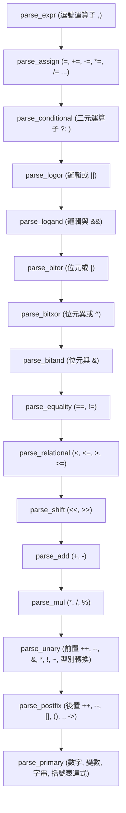

# 第 6 章：遞迴下降語法分析（下）——陳述式、運算式與指標算術

> 「許多人學 C 語言時以為 `ptr + 1` 只是把記憶體位址加一；編譯器卻知道，這背後隱藏著一場乘上型別尺規（Stride）的縮放魔法。」

在建立好宣告解析與符號表後，語法分析器的下半場便是處理真實的程式邏輯——**陳述式（Statements）**與**運算式（Expressions）**。

陳述式負責控制程式碼的執行流向（迴圈、分支、跳躍），而運算式則是計算資料數值的運算網。在 C 語言中，運算式有高達 15 層嚴格的運算子優先級（Operator Precedence），且充斥著短路求值、三元運算子、複合賦值、以及最關鍵的**指標算術縮放（Pointer Scaling）**。

在本章中，我們將探討 XCC 如何在 [`src/parser.c`](file:///Users/hcwtony/repo/projects/ccompiler/src/parser.c) 中利用遞迴下降演算法自然實現 15 層運算子優先級爬升，深入剖析指標加減與差值計算的語意細節，並實作左值（Lvalue）求值與編譯期常數折疊（Constant Folding）。

---

## 6.1 控制流程陳述式（Statements）

陳述式是 C 語言程式執行的基本單位。在 [`include/xcc.h`](file:///Users/hcwtony/repo/projects/ccompiler/include/xcc.h#L259-L275) 中，我們定義了對應的陳述式 AST 節點：

```c
typedef enum {
    /* Statements */
    ND_BLOCK,        /* 複合陳述 { ... } */
    ND_IF,           /* if (cond) then else */
    ND_WHILE,        /* while (cond) body */
    ND_DO_WHILE,     /* do body while (cond); */
    ND_FOR,          /* for (init; cond; inc) body */
    ND_SWITCH,       /* switch (cond) body */
    ND_CASE,         /* case val: */
    ND_DEFAULT,      /* default: */
    ND_BREAK,        /* break; */
    ND_CONTINUE,     /* continue; */
    ND_RETURN,       /* return expr; */
    ND_GOTO,         /* goto label; */
    ND_LABEL,        /* label: stmt */
    ND_EXPR_STMT,    /* expr; */
    // ...
} NodeKind;
```

在 [`src/parser.c`](file:///Users/hcwtony/repo/projects/ccompiler/src/parser.c) 中，`parse_stmt` 是一個清晰的分派迴圈：
* **`if-else` 分支**：解析 `cond` 表達式，接著解析 `then_branch`。若後續緊跟 `else` 關鍵字，則吃掉 `else` 並解析 `else_branch`。這天然解決了語法學上著名的「懸空 else（Dangling Else）」問題（內層 `if` 優先結合）。
* **迴圈結構**：`while`、`do-while` 與 `for`。其中 `for` 迴圈允許在第一欄進行宣告（C99 語法：`for (int i = 0; ...)`），Parser 會自動先開啟一個局部作用域，確保迴圈計數變數不會洩漏到外層。
* **`switch-case-default`**：Parser 維持一個 `current_switch` 指標。當遇到 `case` 或 `default` 標籤時，將其節點串聯到當前 `switch` 的鏈結串列中，並使用編譯期常數表達式求值器確定 `case` 的比對整數。

---

## 6.2 運算式剖析：15 層運算子優先級的遞迴下降實現

要剖析諸如 `a = b + c * d > 5 && !e` 這樣複雜的運算式，遞迴下降法提供了一種極為優雅的解決方案：**每一個優先級層級對應一個解析函式，由低優先級函式遞迴呼叫高優先級函式**。



### 優先級爬升的經典模式
以加減法（`parse_add`）與乘除法（`parse_mul`）為例：
在 [`src/parser.c`](file:///Users/hcwtony/repo/projects/ccompiler/src/parser.c#L1000-L1013)：
```c
static Node *parse_add(Parser *p) {
    Node *n = parse_mul(p); // 先解析優先級更高的乘除項
    for (;;) {
        SourceLoc loc = p->tok->loc;
        if (consume(p, TOK_PLUS)) {
            Node *r = parse_mul(p);
            n = build_add(n, r, loc); // 指標算術或整數加法
        } else if (consume(p, TOK_MINUS)) {
            Node *r = parse_mul(p);
            n = build_sub(n, r, loc);
        } else {
            return n;
        }
    }
}
```
這個簡單的 `for (;;)` 迴圈自然保證了加減法的**左結合律（Left-Associativity）**：`1 + 2 + 3` 會先將 `1 + 2` 結合成左子節點，再與 `3` 結合成根節點。

---

## 6.3 指標算術縮放（Pointer Arithmetic Scaling）

C 語言最著名的特性之一便是指標算術。在低階組合語言中，記憶體位址只是一個純量整數；但在 C 語言語意中，指標的加減運算隱含了**步長（Stride）**。

在 [`src/parser.c`](file:///Users/hcwtony/repo/projects/ccompiler/src/parser.c#L280-L335) 中，我們實作了 `build_add` 與 `build_sub`：

### 1. 指標加整數：`ptr + i` 與 `i + ptr`
若 `ptr` 指向型別 `T`，則位址增加的真實位元組數應為 $i \times \text{sizeof}(T)$：
```c
static Node *build_add(Node *lhs, Node *rhs, SourceLoc loc) {
    // 1. 純整數加法
    if (is_integer_type(lhs->type) && is_integer_type(rhs->type)) {
        return new_binary(ND_ADD, lhs, rhs, common_type(lhs->type, rhs->type), loc);
    }
    // 2. 指標加指標是非法的！
    if (is_pointer_like(lhs->type) && is_pointer_like(rhs->type)) {
        error_at(loc, "invalid operands to binary '+' (pointer + pointer)");
    }
    // 3. 正規化: 若為 int + ptr，調換位置變成 ptr + int
    if (!is_pointer_like(lhs->type) && is_pointer_like(rhs->type)) {
        Node *tmp = lhs; lhs = rhs; rhs = tmp;
    }
    // 4. 取得基底步長 (Stride)
    int stride = pointee_stride(lhs->type);
    if (stride > 1) {
        // 將右運算元轉換為 rhs * stride
        rhs = new_binary(ND_MUL, rhs, new_int_node(stride, loc), ty_long, loc);
    }
    Type *res_ty = (lhs->type->kind == TY_ARRAY) ? pointer_to(lhs->type->base) : lhs->type;
    return new_binary(ND_ADD, lhs, rhs, res_ty, loc);
}
```

### 2. 指標減整數與指標減指標（Pointer Difference）
* **`ptr - i`**：位址向左退移 $i \times \text{sizeof}(T)$ 個位元組。
* **`ptr1 - ptr2`**：計算兩個同型別指標相隔的元素個數。公式為：
  $$\text{diff} = \frac{\text{addr}(ptr1) - \text{addr}(ptr2)}{\text{sizeof}(T)}$$
  因此在 AST 中，XCC 先發射一個 `ND_SUB` 計算二者位址差值，隨後發射一個 `ND_DIV` 除以 `stride`，回傳型別為 64 位元整數（`long` / `ptrdiff_t`）。

---

## 6.4 左值（Lvalue）、成員存取與複合賦值

在運算式中，我們必須清楚區分：
* **左值（Lvalue）**：代表記憶體中的一個儲存實體（可取位址），例如變數 `x`、陣列索引 `a[i]`、解引用 `*p`、成員 `s.m`。
* **右值（Rvalue）**：代表純粹的數值計算結果，例如 `10 + 20`。

### 1. 陣列索引語法糖：`a[i] == *(a + i)`
在 C 語言中，陣列存取 `a[i]` 完全等價於 `*(a + i)`。在 [`src/parser.c`](file:///Users/hcwtony/repo/projects/ccompiler/src/parser.c) 中，當遇到方括號 `[` 時，Parser 直接呼叫：
```c
Node *idx = parse_expr(p);
expect(p, TOK_RBRACKET);
Node *add = build_add(expr, idx, loc);
expr = new_unary(ND_DEREF, add, add->type->base, loc);
```
這段漂亮的轉譯完美結合了上一節的指標步長縮放，自動處理了陣列元素位址的偏移與解引用。

### 2. 成員存取運算子：`.` 與 `->`
* **`s.member`**：左側必須是結構體或聯合體。Parser 透過 `find_struct_member` 查得成員的偏移量 `offset` 與型別，建構 `ND_MEMBER` 節點。
* **`ptr->member`**：完全等價於 `(*ptr).member`。Parser 先對指標建構 `ND_DEREF` 節點，再進行成員存取。

### 3. 複合賦值與前置／後置遞增遞減
考慮 `x += 5` 或 `a[i++] += 2`。若直接展開為 `a[i++] = a[i++] + 2`，會導致左值被重複求值兩次（副作用重複執行！）。
在 [`src/parser.c`](file:///Users/hcwtony/repo/projects/ccompiler/src/parser.c#L1130-L1150) 中，我們實作了 `build_compound_assign`：
1. 建立一個暫存指標區域變數 `tmp_ptr = &lhs`。
2. 透過暫存指標讀取一次舊值：`*tmp_ptr`。
3. 計算加法並寫回：`*tmp_ptr = *tmp_ptr + rhs`。
4. 確保左值運算式（包括複雜的陣列或函式呼叫傳回的指標）只被精確計算一次。

---

## 6.5 編譯期常數折疊（Constant Expression Evaluation）

在 C 語言中，陣列宣告長度 `int arr[10 * 4];`、列舉值 `enum { X = 1 << 3 };`、`case` 標籤、以及全域變數初始值必須是編譯期常數。

在 [`src/parser.c`](file:///Users/hcwtony/repo/projects/ccompiler/src/parser.c#L340-L430) 中，我們實作了 `eval_node_const`。它遞迴走訪 AST 節點：
* 遇到純數字 `ND_INT_LIT` 直接回傳其值。
* 遇到單元運算（負號 `-`、位元反相 `~`、邏輯非 `!`）直接計算結果。
* 遇到二元算術（`+`, `-`, `*`, `/`, `%`, `<<`, `>>`, `&`, `|`, `^`）與關係運算，在編譯器執行期直接算出數值。
* 遇到三元運算子 `cond ? a : b`，若條件為真則只計算 `a` 分支。
* 若遇到非編譯期常數節點（如區域變數存取或函式呼叫），則呼叫 `error_at` 印出清晰的錯誤：`expression is not a compile-time constant`。

---

## 6.6 第二篇總結與完整 AST 生成

至此，我們已經成功跨越了編譯器前端最複雜的山嶺——**語法分析與型別系統（Ch 4 – Ch 6）**！

讓我們綜覽目前的成果：
1. **型別系統（第 4 章）**：建立了 LP64 模型下的完整型別階層、結構體記憶體邊界自然對齊與尾端填補演算法。
2. **宣告與符號表（第 5 章）**：實作了雙命名空間作用域，克服了複雜的遞迴宣告符（指標、陣列、函式），並構建了全域常數初始化串列。
3. **語意分析與 AST（第 6 章）**：透過 15 層遞迴下降演算法完成了運算子優先級爬升、指標算術縮放、結構體成員存取與短路邏輯。

現在，原始碼文字已經徹底脫胎換骨，轉換為語意完整、型別嚴謹的**抽象語法樹（ProgramAST）**。

在接下來的**第三篇（第 7～10 章）**中，我們將離開語法世界，進入純粹的計算機架構——我們將學習如何將樹狀的 AST 降階為平台無關的**三址碼（Three-Address Code IR）**，建立可直接執行的 **IR 虛擬機**，並向 **ARM64 與 x86_64 原生後端**全速進發！
