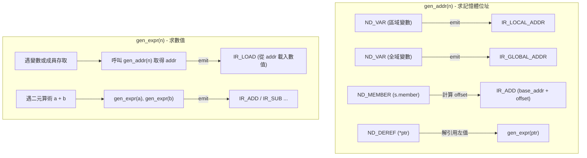

# 第 7 章：平台無關三址碼中間表示（Three-Address Code IR）

> 「AST 是人類語法思維的投影，機器碼是矽晶片物理架構的束縛；中間表示（IR），則是連通這兩座孤島的巴別塔。」

在前兩篇中，我們完成了一個能將原始 C 程式碼轉換為語意完整、型別嚴謹的抽象語法樹（AST）的前端。此時許多初學者會忍不住問：「我們能不能直接走訪 AST，然後根據不同的 CPU 架構印出組合語言？」

答案是：**可以，但你會付出極其慘痛的代價**。

如果編譯器直接從 AST 產生組合語言：
1. **$M \times N$ 的組合爆炸**：若前端支援 3 種語言（C、C++、Rust），後端支援 4 種架構（ARM64、x86_64、RISC-V、Wasm），直接生成需要撰寫 $3 \times 4 = 12$ 套轉譯器；而引入中間表示（IR）後，只需 $3 + 4 = 7$ 套。
2. **語意過於複雜**：AST 充滿了巢狀結構、短路求值、三元運算、型別提升與結構體賦值，硬體 CPU 根本沒有與之一對一對應的指令。
3. **無法進行通用安全強化與混淆**：若想在 ARM64 和 x86_64 上都實現控制流平坦化或混淆虛擬機，你必須在每個硬體架構後端把複雜的防護演算法重寫一次。

在本章中，我們將深入剖析 XCC 如何在 [`include/xcc.h`](file:///Users/hcwtony/repo/projects/ccompiler/include/xcc.h) 與 [`src/ir.c`](file:///Users/hcwtony/repo/projects/ccompiler/src/ir.c) 中設計平台無關的**三址碼線性中間表示（Three-Address Code, TAC IR）**，並實作由樹狀 AST 降階（Lowering）至線性指令流的完整演算法。

---

## 7.1 線性三址碼架構與指令集設計

所謂「三址碼（Three-Address Code, TAC）」，指的是每條指令最多包含三個運算元位址：一個目標（Destination）與至多兩個來源（Source 1, Source 2），形式如：
$$dst = src_1 \ \mathbf{op} \ src_2$$

在 [`include/xcc.h`](file:///Users/hcwtony/repo/projects/ccompiler/include/xcc.h#L430-L502) 中，我們定義了 XCC 的核心 IR 操作碼 [`IROp`](file:///Users/hcwtony/repo/projects/ccompiler/include/xcc.h#L430-L482) 與指令結構體 [`IRInst`](file:///Users/hcwtony/repo/projects/ccompiler/include/xcc.h#L484-L502)：

```c
typedef enum {
    IR_NOP = 0,
    
    /* 數值載入與位址解析 */
    IR_IMM,          /* dst = imm */
    IR_STR_ADDR,     /* dst = &string_literal[imm] */
    IR_LOCAL_ADDR,   /* dst = &local_slot[imm] */
    IR_GLOBAL_ADDR,  /* dst = &global_symbol[name] */
    IR_MOV,          /* dst = src1 */

    /* 記憶體存取 */
    IR_LOAD,         /* dst = *[src1] (按 mem_size 與 is_unsigned 載入) */
    IR_STORE,        /* *[src1] = src2 (按 mem_size 寫入) */
    IR_MEMCPY,       /* 記憶體拷貝: memcpy(src1, src2, imm) */

    /* 單元運算與型別轉換 */
    IR_NEG,          /* dst = -src1 */
    IR_BITNOT,       /* dst = ~src1 */
    IR_LOGNOT,       /* dst = !src1 */
    IR_CAST,         /* dst = (cast) src1 */

    /* 二元算術與位元運算 */
    IR_ADD, IR_SUB, IR_MUL, IR_DIV, IR_MOD,
    IR_BITAND, IR_BITOR, IR_BITXOR, IR_SHL, IR_SHR,

    /* 關係比較運算 (回傳 0 或 1) */
    IR_EQ, IR_NE, IR_LT, IR_LE, IR_GT, IR_GE,

    /* 控制流跳躍 */
    IR_LABEL,        /* .L<label>: 標籤定義 */
    IR_JMP,          /* 無條件跳躍: goto .L<label> */
    IR_JZ,           /* 條件跳躍: if (src1 == 0) goto .L<label> */
    IR_JNZ,          /* 條件跳躍: if (src1 != 0) goto .L<label> */

    /* 函式呼叫與回傳 */
    IR_ARG,          /* 準備呼叫引數: arg[imm] = src1 */
    IR_CALL,         /* dst = call sym_name(argc, fixed_params) */
    IR_RET,          /* return src1 (若 src1 == -1 則為 void) */
} IROp;
```

### 虛擬暫存器（Virtual Registers）與無限假設
在硬體層面，ARM64 只有 31 個通用暫存器，x86_64 只有 16 個；但在三址碼 IR 階段，我們採用**無限虛擬暫存器假設（Infinite Virtual Registers）**：
* 每個計算暫存結果都分配一個全新、唯一的虛擬暫存器編號 `%v0, %v1, %v2, ...`。
* 暫存器分配與溢出（Spilling）問題完全留給後端處理，讓 IR 生成過程極度清晰且純粹。

---

## 7.2 AST 降階（Lowering）核心分工：`gen_addr` vs. `gen_expr`

將巢狀樹狀的 AST 壓平成線性 IR 的最大難點，在於**左值（Lvalue，表示記憶體位址）與右值（Rvalue，表示計算結果數值）的截然不同**。

在 [`src/ir.c`](file:///Users/hcwtony/repo/projects/ccompiler/src/ir.c#L85-L150) 中，我們設計了兩個互為陰陽的核心生成函式：
* `int gen_addr(IRBuilder *b, const Node *n)`：**計算左值節點的記憶體位址**，回傳存放該 64 位元位址的虛擬暫存器編號。
* `int gen_expr(IRBuilder *b, const Node *n)`：**計算運算式的值**，回傳存放計算結果的虛擬暫存器編號。



### 經典降階範例：賦值運算式 `x = y + 1`
當編譯器遇到賦值節點 `ND_ASSIGN` 時：
1. 對左側呼叫 `gen_addr(n->lhs)`：
   * 若 `x` 是區域變數，發射指令 `%v0 = local_addr #slot_id`。
2. 對右側呼叫 `gen_expr(n->rhs)`：
   * 遞迴計算 `y + 1`，發射指令 `%v1 = local_addr #y` $\to$ `%v2 = load [%v1]` $\to$ `%v3 = imm 1` $\to$ `%v4 = add %v2, %v3`。
3. 發射儲存指令：
   * `store [%v0], %v4`（將 `%v4` 寫入 `%v0` 所指向的記憶體）。

透過將「取址」與「取值」徹底解耦，即便是多級指標如 `***p = 42;` 或深層結構體成員賦值 `a[i].node->val = 10;`，都能被優雅且正確地展開為乾淨的線性位址計算與 `store` 指令序列。

---

## 7.3 控制流平坦化與短路邏輯的條件跳躍展開

硬體 CPU 只有比較與跳躍指令，不存在高階語言的 `while` 迴圈或 `&&` / `||` 短路邏輯。在 IR 生成階段，我們必須將這些高階結構平坦化為基於標籤（Labels）與跳躍（Jumps）的控制流圖（Control Flow Graph, CFG）。

### 1. `while` 迴圈降階
在 [`src/ir.c`](file:///Users/hcwtony/repo/projects/ccompiler/src/ir.c#L460-L490) 中，一個 `while (cond) { body; }` 被平坦化為：
```
.L_cond:
    %v_cond = gen_expr(cond)
    jz %v_cond, .L_break        ; 條件不成立，跳出迴圈
.L_body:
    gen_stmt(body)
    jmp .L_cond                 ; 跳回條件檢查
.L_break:
```
此時，若 `body` 內部出現 `break` 或 `continue`，只需分別無條件跳躍到 `.L_break` 或 `.L_cond` 即可。

### 2. 邏輯短路求值：`A && B`
在 C 語言中，若 `A` 為假，則 `B` 絕對不能被執行（例如 `ptr != NULL && *ptr > 0`）。
在 [`src/ir.c`](file:///Users/hcwtony/repo/projects/ccompiler/src/ir.c#L280-L306) 中，`ND_LOGAND` 被展開為：
```
    %v_l = gen_expr(A)
    jz %v_l, .L_false           ; A 為 0，短路跳躍！
    %v_r = gen_expr(B)
    jz %v_r, .L_false           ; B 為 0，跳躍！
    %v_res = imm 1              ; 兩者皆真，設為 1
    jmp .L_end
.L_false:
    %v_res = imm 0              ; 設為 0
.L_end:
```
這種平坦化確保了運算式的副作用（Side Effects）嚴格符合 C 語言標準規範。

---

## 7.4 結構體拷貝與函式呼叫的 IR 約定

### 1. 結構體整體賦值（`IR_MEMCPY`）
在 C 語言中，結構體賦值是值傳遞（By-Value Copy），例如 `struct Point p2 = p1;`。
在 [`src/ir.c`](file:///Users/hcwtony/repo/projects/ccompiler/src/ir.c#L150-L157) 中，當 `emit_store_to` 發現目標型別為結構體或聯合體時：
* 它不會發射一般的單一數值暫存器寫入指令。
* 而是直接發射 `IR_MEMCPY`：
  ```
  memcpy dst_addr, src_addr, imm=sizeof(struct Point)
  ```
這為後端提供了極大的最佳化彈性（小結構體可轉為暫存器拷貝，大結構體可調用系統 `memcpy` 或重複搬移迴圈）。

### 2. 巢狀函式呼叫防暫存器覆蓋（Register Clobber Protection）
考慮巢狀呼叫：`foo(bar(1), baz(2))`。
若我們先發射 `arg #0 = bar(1)`，接著在準備第二個引數時呼叫 `baz(2)`，`baz` 內部的暫存器與呼叫約定可能會徹底摧毀剛剛計算好的第一個引數！
為了避免此致命問題，在 [`src/ir.c`](file:///Users/hcwtony/repo/projects/ccompiler/src/ir.c#L357-L373) 中，我們採取了**先求值、後傳參**的兩階段演算法：
1. **第一階段（Evaluation Phase）**：走訪所有引數節點，將它們各自遞迴計算至獨立的虛擬暫存器陣列 `arg_vregs[i]` 中。此時所有巢狀呼叫已全部執行完畢。
2. **第二階段（Binding Phase）**：依序發射 `IR_ARG` 指令將各個 `arg_vregs[i]` 綁定至引數插槽，最後發射單一的 `IR_CALL` 指令。

---

## 7.5 動手檢視：`--emit-ir` 視覺化

現在讓我們透過 XCC 內建的 IR Pretty-Printer（[`dump_ir`](file:///Users/hcwtony/repo/projects/ccompiler/src/ir.c#L700-L850)）來檢視一個實例。

建立測試檔案 `simple.c`：
```c
int max(int a, int b) {
    if (a > b) return a;
    return b;
}
```

執行命令：
```bash
./xcc --emit-ir simple.c
```

你將看到如手術刀般精準清晰的線性三址碼：
```
func max(param_count=2, locals=2):
  %v2 = local_addr #0
  %v3 = load.4 [%v2]
  %v4 = local_addr #1
  %v5 = load.4 [%v4]
  %v6 = cmp.gt %v3, %v5
  jz %v6, .L1
  %v7 = local_addr #0
  %v8 = load.4 [%v7]
  ret %v8
.L1:
  %v9 = local_addr #1
  %v10 = load.4 [%v9]
  ret %v10
```

---

## 7.6 小結

在本章中，我們掌握了：
1. 為什麼平台無關的中間表示（IR）是現代編譯器解耦前端與後端的唯一核心途徑。
2. XCC 三址碼（TAC）的指令集設計與無限虛擬暫存器模型。
3. `gen_addr`（求位址）與 `gen_expr`（求數值）的 AST 降階演算法。
4. 控制流結構化（`while`、`if`）、邏輯短路與結構體拷貝的線性展開。

在有了這套極度乾淨的 IR 之後，我們面臨一個極具誘惑力的選擇：**在寫硬體組合語言後端之前，我們能不能直接在記憶體中把這段 IR 跑起來？**

在下一章中，我們將實作一個令人驚艷的工具：**內建跨平台 IR 虛擬機（`--run-ir`）**！
