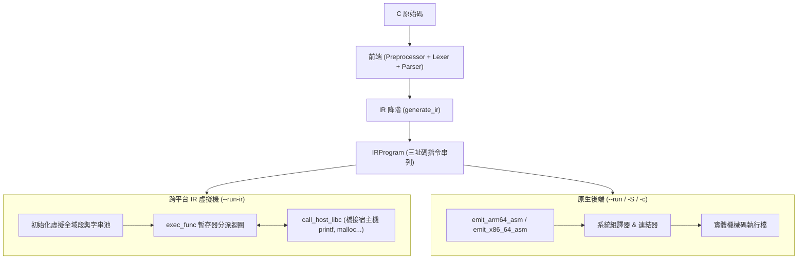

# 第 8 章：內建跨平台 IR 虛擬機（The Built-in IR VM）

> 「在編譯器開發中，最令人沮喪的時刻莫過於：程式碼跑出 Segmentation Fault，而你完全不知道問題出在語法剖析、型別計算、還是組合語言的堆疊指標少移了 8 個位元組。」

編譯器工程是一條漫長且容易出錯的管線。當一個由編譯器產生的執行檔當機時，除錯空間往往極大：是 Parser 的 AST 節點建錯了？是 IR 降階邏輯有誤？還是目標架構（ARM64 / x86_64）的呼叫慣例（ABI）暂存器沒對齊？

如果我們必須等到寫完複雜的組合語言後端才能驗證前端的正確性，除錯效率將極為低下。

XCC 在架構上採用了一個極具前瞻性的策略：**在實作原生硬體後端之前，先打造一個內建的跨平台 IR 虛擬機（`src/vm.c`，透過命令列參數 `--run-ir` 啟動）**。

本章將帶領讀者完整建構這個 IR 直譯器。我們將探討如何為 IR 程式建立虛擬位址空間、動態配置全域資料段與呼叫堆疊框、走訪分派 64 位元虛擬指令，並透過 **Host Libc FFI** 機制無縫橋接宿主機的 C 標準庫（`printf`, `malloc`, `free` 等）。

---

## 8.1 即時驗證利器 `--run-ir` 的架構定位

IR 虛擬機本質上是一個**高階字元碼直譯器（Bytecode/IR Interpreter）**。它不產生任何磁碟檔案，不呼叫系統組譯器（`as`）與連結器（`ld`），而是直接在記憶體中走訪 `IRProgram` 並依序執行每條三址碼指令。



### 雙軌驗證的威力
有了 IR VM，我們獲得了一個「**絕對參考標準（Ground Truth）**」：
* 當某個測試案例在 `--run-ir` 下順利通過，卻在原生執行（`--run`）時出錯，我們便能 100% 確定問題**只出在組合語言後端代碼生成**！
* 當我們在第四篇對 IR 套用複雜的高強度混淆（MBA、CFF、VM 虛擬化）時，可以先用 `--run-ir` 快速進行邏輯等價性回歸測試，大幅縮短研發週期。

---

## 8.2 虛擬執行環境與記憶體佈局

在 [`src/vm.c`](file:///Users/hcwtony/repo/projects/ccompiler/src/vm.c#L7-L35) 中，我們定義了虛擬機的執行狀態：

```c
typedef struct {
    const char *name;
    uint8_t *addr;        /* 指向宿主機記憶體中的真實資料緩衝區 */
    int size;             /* 變數大小 */
} VMGlobal;

typedef struct {
    const IRProgram *ir;
    VMGlobal *globals;    /* 全域變數表 */
    int global_count;
    uint8_t **str_addrs;  /* 字串池真實位址映射表 */
    int max_str_id;
} VMState;
```

### 1. 全域變數段與常數初始化
在 VM 啟動時（`run_ir_vm`），它會掃描 `ir->globals`：
1. 為每個全域變數調用 `calloc` 配置一塊專屬的真實記憶體空間。
2. 走訪 `GlobalInit` 串列，將純量數值拷貝至對應的 `offset`。
3. 若遇到帶有符號標籤的指標初始化（例如全域指標指向字串 `.L.str.0` 或另一個全域變數），VM 自動將該字串或全域變數在宿主機中的真實記憶體位址（`uintptr_t`）寫入該欄位！

### 2. 函式呼叫堆疊框（Stack Frame）動態配置
當進入一個函式（`exec_func`）時，VM 為該次呼叫動態配置一個堆疊框：
```c
// 1. 計算所有區域變數插槽 (IRLocalSlot) 的總位元組數與 8-byte 對齊偏移量
int total_local_bytes = 0;
int *slot_offsets = (int *)calloc(fn->local_count, sizeof(int));
for (int i = 0; i < fn->local_count; i++) {
    total_local_bytes = (total_local_bytes + 7) & ~7;
    slot_offsets[i] = total_local_bytes;
    total_local_bytes += fn->locals[i].size;
}

// 2. 配置連續的堆疊記憶體 (frame_mem) 與虛擬暫存器陣列 (vregs)
uint8_t *frame_mem = (uint8_t *)calloc(1, total_local_bytes + 16);
int64_t *vregs = (int64_t *)calloc(fn->vreg_count, sizeof(int64_t));
```
這意味著 IR 中的指令 `IR_LOCAL_ADDR` 只需要簡單地計算 `frame_mem + slot_offsets[local_id]`，就能得到一個合法的記憶體指標。

---

## 8.3 虛擬暫存器分派迴圈（Dispatch Loop）

在 [`src/vm.c`](file:///Users/hcwtony/repo/projects/ccompiler/src/vm.c#L137-L315) 中，核心分派器是一個由虛擬程式計數器 `pc` 驅動的高速 `switch` 迴圈：

```c
int pc = 0;
while (pc < fn->inst_count) {
    const IRInst *in = &fn->insts[pc++];
    switch (in->op) {
        case IR_IMM:
            vregs[in->dst] = in->imm;
            break;

        case IR_LOCAL_ADDR:
            vregs[in->dst] = (int64_t)(uintptr_t)(frame_mem + slot_offsets[in->imm]);
            break;

        case IR_GLOBAL_ADDR:
            vregs[in->dst] = (int64_t)(uintptr_t)find_vm_global(vm, in->sym_name);
            break;

        case IR_LOAD: {
            const void *ptr = (const void *)(uintptr_t)vregs[in->src1];
            if (in->mem_size == 1) {
                vregs[in->dst] = in->is_unsigned ? (int64_t)*(const uint8_t *)ptr : (int64_t)*(const int8_t *)ptr;
            } else if (in->mem_size == 4) {
                vregs[in->dst] = in->is_unsigned ? (int64_t)*(const uint32_t *)ptr : (int64_t)*(const int32_t *)ptr;
            } else {
                vregs[in->dst] = *(const int64_t *)ptr;
            }
            break;
        }

        case IR_STORE: {
            void *ptr = (void *)(uintptr_t)vregs[in->src1];
            int64_t v = vregs[in->src2];
            if (in->mem_size == 1) *(uint8_t *)ptr = (uint8_t)v;
            else if (in->mem_size == 4) *(uint32_t *)ptr = (uint32_t)v;
            else *(int64_t *)ptr = v;
            break;
        }

        case IR_ADD: vregs[in->dst] = vregs[in->src1] + vregs[in->src2]; break;
        case IR_SUB: vregs[in->dst] = vregs[in->src1] - vregs[in->src2]; break;
        case IR_MUL: vregs[in->dst] = vregs[in->src1] * vregs[in->src2]; break;
        case IR_DIV:
            if (in->is_unsigned) vregs[in->dst] = (int64_t)((uint64_t)vregs[in->src1] / (uint64_t)vregs[in->src2]);
            else vregs[in->dst] = vregs[in->src1] / vregs[in->src2];
            break;

        case IR_JMP:
            pc = find_label_pc(fn, in->label);
            break;

        case IR_JZ:
            if (vregs[in->src1] == 0) pc = find_label_pc(fn, in->label);
            break;

        case IR_JNZ:
            if (vregs[in->src1] != 0) pc = find_label_pc(fn, in->label);
            break;

        case IR_RET:
            ret_val = (in->src1 >= 0) ? vregs[in->src1] : 0;
            goto cleanup;
    }
}
```

這個分派器純粹使用 64 位元整數（`int64_t`）作為虛擬暫存器容器，並在 `IR_LOAD` / `IR_STORE` / `IR_CAST` 時精確根據 `mem_size` 與 `is_unsigned` 執行符號擴展（Sign Extension）或零擴展（Zero Extension），完美契合現代 64 位元硬體的運作行為。

---

## 8.4 宿主機標準庫橋接（Host Libc FFI）

如果 IR 虛擬機只能執行純運算而無法輸出文字或配置動態記憶體，它的實用性將大打折扣。
在 [`src/vm.c`](file:///Users/hcwtony/repo/projects/ccompiler/src/vm.c#L37-L110) 中，當遇到函式呼叫 `IR_CALL` 時：
1. VM 首先在 `ir->funcs` 中尋找是否為使用者自定義函式；若有，則遞迴調用 `exec_func` 執行被呼叫的函式。
2. 若找不到，代表這是一個**外部符號（External Symbol）**！此時 VM 呼叫 [`call_host_libc`](file:///Users/hcwtony/repo/projects/ccompiler/src/vm.c#L38-L110) 進行 FFI（Foreign Function Interface）橋接：

```c
static int64_t call_host_libc(const char *name, int argc, const int64_t *args) {
    if (strcmp(name, "putchar") == 0) {
        return putchar((int)args[0]);
    }
    if (strcmp(name, "puts") == 0) {
        return puts((const char *)(uintptr_t)args[0]);
    }
    if (strcmp(name, "printf") == 0) {
        const char *fmt = (const char *)(uintptr_t)args[0];
        // 提取引數並呼叫宿主系統真實的 printf
        return printf(fmt, args[1], args[2], args[3], args[4], args[5], args[6]);
    }
    if (strcmp(name, "malloc") == 0) {
        return (int64_t)(uintptr_t)malloc((size_t)args[0]);
    }
    if (strcmp(name, "free") == 0) {
        free((void *)(uintptr_t)args[0]);
        return 0;
    }
    // ... 支援 strlen, strcmp, memcpy, memset, abs, atoi, exit 等
    fatal_error("IR VM: unimplemented external function '%s'", name);
    return 0;
}
```

### 為什麼這能無縫運作？
因為在第 8.2 節中，虛擬機傳遞的所有記憶體指標（字串位址、全域變數、堆疊框局部變數、`malloc` 傳回的指標）**在宿主機作業系統中都是貨真價實的有效記憶體位址**！
當 IR 程式碼將字串指標傳給 `printf` 時，宿主機的 C 函式庫能夠直接讀取並在終端機印出文字，無需進行繁瑣的位址轉譯。

---

## 8.5 動手實測：`--run-ir` 極速驗證

讓我們來執行專案中的完整測試套件，體驗 IR VM 的執行威力：

```bash
./xcc --run-ir tests/test_suite.c
```

你將看到幾十個涵蓋算術、指標、遞迴、結構體、陣列、字串操作的測試案例在**不到 0.05 秒**內全部通過！在不產生任何臨時檔案、不透過 Clang/GCC 組譯的情況下，我們已經擁有了一個具備完整執行能力的跨平台 C 語言執行引擎。

---

## 8.6 小結

在本章中，我們掌握了：
1. 為什麼在編譯器管線中加入內建 IR VM 能讓除錯效率提高數倍。
2. 虛擬全域記憶體段、字串池與動態呼叫堆疊框的構建方式。
3. 64 位元暫存器分派迴圈與精確記憶體存取寬度處理。
4. 利用 Host Libc FFI 橋接原生標準函式庫的原理。

現在，前端與中端已經徹底驗證完畢。在接下來的**第 9 章與第 10 章**中，我們將昂首邁向硬體底層，深入 **ARM64（AArch64）與 x86_64 原生組合語言與 ABI 的世界**！
