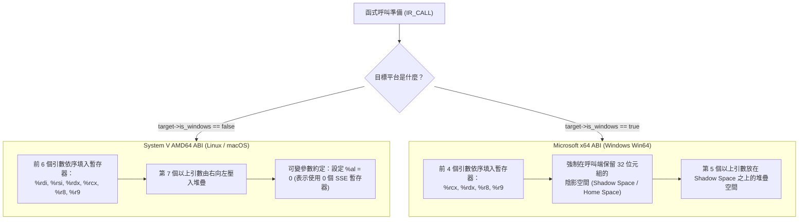

# 第 10 章：x86_64 (AMD64) 原生後端：System V 與 Windows Win64 ABI

> 「如果說 ARM64 是一輛精準優雅的現代跑車，那麼 x86_64 就是一輛背負著四十年相容性包袱、卻依然能在地表狂飆的鋼鐵重裝坦克。」

自從 AMD 於 2000 年推出 AMD64 架構並被 Intel 採用為 EM64T 以來，x86_64 一直是現代雲端資料中心、個人電腦以及高效能運算的基石。

與 ARM64 乾淨規整的 RISC 架構不同，x86_64 屬於複雜指令集（CISC）：它擁有變長指令編碼、允許記憶體運算元直接參與算術、並對特異暫存器（如除法強制綁定 `%rax:%rdx`、移位強制綁定 `%cl`）有著嚴苛的歷史約束。

更具挑戰性的是，在 x86_64 領域中，作業系統陣營發生了嚴重分裂：
* **Unix-like 世界（Linux, macOS, BSD）**：採用 **System V AMD64 ABI**。
* **微軟陣營（Windows x64 / MinGW）**：採用特立獨行的 **Microsoft x64 ABI（Win64 ABI）**。

在本章中，我們將深入剖析 XCC 的 x86_64 代碼生成器（[`src/codegen_x86_64.c`](file:///Users/hcwtony/repo/projects/ccompiler/src/codegen_x86_64.c)）。我們將探討 AT&T 組合語言語法、RIP-Relative 位置無關尋址、特殊算術指令的暫存器排程，並對決 System V 與 Windows Win64 ABI（包括其最具代表性的 **32-Byte Shadow Space**）。

---

## 10.1 x86_64 暫存器架構與 AT&T 語法慣例

在 64 位元模式下，x86_64 將暫存器數量由 32 位元的 8 個擴展為 16 個通用暫存器：

| 64 位元暫存器 | 32 位元低階名稱 | 歷史角色 / 慣用功能 |
| :--- | :--- | :--- |
| `%rax` | `%eax` | 累加器（Accumulator）/ 函式回傳值 |
| `%rbx` | `%ebx` | 基底暫存器（Base Register / Callee-saved） |
| `%rcx` | `%ecx` | 計數器（Counter）/ 移位指令位移量 |
| `%rdx` | `%edx` | 資料暫存器（Data）/ 乘除法輔助高階暫存器 |
| `%rsi` | `%esi` | 來源索引（Source Index）/ System V 第 2 引數 |
| `%rdi` | `%edi` | 目的索引（Destination Index）/ System V 第 1 引數 |
| `%rbp` | `%ebp` | 框架指標（Base Pointer） |
| `%rsp` | `%esp` | 堆疊指標（Stack Pointer，**硬體要求 16-byte 對齊**） |
| `%r8` – `%r15` | `%r8d` – `%r15d` | AMD64 新增的 8 個擴展暫存器 |

### XCC 選擇 AT&T 語法的理由
GCC 與 Clang 預設產生的組合語言均採用 **AT&T 語法**（而非 Intel 語法）：
1. **運算方向**：`movq 來源, 目的`（由左向右，例如 `movq $10, %rax` 是將 10 存入 `%rax`）。
2. **前綴標記**：暫存器前帶 `%`，立即常數前帶 `$`。
3. **記憶體尋址**：`偏移量(基底, 索引, 比例)` 代表 `基底 + 索引 * 比例 + 偏移量`，例如 `-16(%rbp)` 代表 `[%rbp - 16]`。

---

## 10.2 函式堆疊框與 RIP-Relative 尋址

### 1. 標準序言與結尾
在 [`src/codegen_x86_64.c`](file:///Users/hcwtony/repo/projects/ccompiler/src/codegen_x86_64.c#L130-L160) 中，函式的標準序言與結尾如下：
```gas
_my_func:
  pushq %rbp              # 將舊的 RBP 壓入堆疊 (此時 RSP 自動減 8)
  movq %rsp, %rbp         # 設定當前 RBP 為新的框架底端
  subq $total_frame, %rsp # 為局部變數與虛擬暫存器配置堆疊空間

  # ... 函式本體指令 ...

  movq %rbp, %rsp         # 還原堆疊頂端
  popq %rbp               # 還原舊 RBP
  retq                    # 彈出回傳位址並跳躍
```

> [!IMPORTANT]
> **堆疊對齊鐵律**：CPU 在執行 `callq` 跳入函式時，會自動將 8 位元組的回傳位址壓入堆疊；接著序言執行 `pushq %rbp`（再壓入 8 位元組）。此時堆疊共壓入了 16 位元組，剛好維持在 16-byte 對齊邊界上。因此，後續的 `subq $total_frame, %rsp` 中的 `total_frame` **必須嚴格是 16 的倍數**（`align16`）。

### 2. 位置無關碼（PIC）與 RIP-Relative 尋址
在 64 位元 Linux/macOS 上，為了安全機制 ASLR，執行檔必須具備位置無關性。我們存取字串字面量時，透過相對於程式計數器（`%rip`）的位移達成：
```gas
leaq .L.str.0(%rip), %rax   # 將字串真實位址載入 %rax
```
若在 macOS Mach-O 上存取外部全域變數，則透過 GOT（Global Offset Table）：
```gas
movq _my_global@GOTPCREL(%rip), %rax
```

---

## 10.3 攻克 CISC 限制：乘除法與移位指令的暫存器特異性

x86_64 保留了 8086 時代的硬體歷史遺產，某些運算子不能隨意使用任意暫存器：

### 1. 帶號除法與取餘數（`idivq`）
在 [`src/codegen_x86_64.c`](file:///Users/hcwtony/repo/projects/ccompiler/src/codegen_x86_64.c#L330-L360) 中，指令 `idivq` **強制要求被除數為 128 位元，且必須固定放在 `%rdx:%rax` 暫存器中**！
* 在執行除法前，必須先使用 `cqto`（Convert Quadword to Octaword）將 `%rax` 的符號位元自動擴展到整個 `%rdx` 中。
* 執行 `idivq %rcx` 後：
  * 商數（Quotient）固定存放在 **`%rax`**。
  * 餘數（Remainder）固定存放在 **`%rdx`**。

```gas
movq -16(%rbp), %rax    # 載入被除數
movq -24(%rbp), %rcx    # 載入除數
cqto                    # 將 %rax 符號擴展至 %rdx:%rax
idivq %rcx              # 除以 %rcx
# 若為 IR_DIV，取 %rax；若為 IR_MOD，取 %rdx！
```

### 2. 位元移位指令（`shlq` / `shrq` / `sarq`）
x86_64 的可變位移指令，其位移位元數**只能來自立即數常數，或是唯一定義的暫存器 `%cl`（`%rcx` 的最低 8 位元）**！
因此在降階 `IR_SHL` / `IR_SHR` 時，XCC 會自動將右運算元載入至 `%rcx`，然後發射 `shlq %cl, %rax`。

---

## 10.4 兩大 ABI 正面對決：System V vs. Windows Win64

這是跨平台編譯器最精彩的後端戰場。Linux/macOS 與 Windows 對「如何傳遞函式參數」產生了巨大的分歧：



### 1. 引數暫存器清單的重大分歧
在 [`src/codegen_x86_64.c`](file:///Users/hcwtony/repo/projects/ccompiler/src/codegen_x86_64.c#L100-L125) 中：
```c
static const char *k_sysv_arg_regs[] = {
    "%rdi", "%rsi", "%rdx", "%rcx", "%r8", "%r9"
};

static const char *k_win64_arg_regs[] = {
    "%rcx", "%rdx", "%r8", "%r9"
};
```
* 注意：Windows 連第一個暫存器都不一樣（Windows 用 `%rcx`，而 System V 用 `%rdi`）！

### 2. Windows 獨有的「陰影空間（Shadow Space）」
在 Windows Win64 ABI 規範中，**任何函式在執行 `callq` 前，呼叫者（Caller）的堆疊頂端必須額外配置至少 32 位元組（4 個 64-bit slots）的空白空間**！

為什麼微軟要設計 Shadow Space？
因為被呼叫者（Callee）若需要將傳入暫存器的前 4 個引數（`%rcx, %rdx, %r8, %r9`）傾印到記憶體時，可以直接把這 4 個暫存器存入這 32 位元組中，而不需要自己在堆疊框重新開闢空間。

在 [`src/codegen_x86_64.c`](file:///Users/hcwtony/repo/projects/ccompiler/src/codegen_x86_64.c#L513-L545) 中，我們透過優雅的公式統一了兩大 ABI：

```c
case IR_CALL: {
    int argc = in->call_arg_count;
    int reg_limit = target->is_windows ? 4 : 6;
    int reg_args = argc < reg_limit ? argc : reg_limit;
    int stack_args = argc > reg_limit ? (argc - reg_limit) : 0;
    
    // Windows 強制保留 32 bytes Shadow Space，System V 為 0
    int shadow_space = target->is_windows ? 32 : 0;
    int stack_bytes = align16(shadow_space + stack_args * 8);

    // 1. 配置堆疊空間 (包含 Shadow Space 與堆疊引數)
    if (stack_bytes > 0) {
        fprintf(out, "  subq $%d, %%rsp\n", stack_bytes);
        for (int a = 0; a < stack_args; a++) {
            int vreg = pending_args[reg_limit + a];
            fprintf(out, "  movq -%d(%%rbp), %%rax\n", vreg_offset(vreg_base, vreg));
            // 引數放在 shadow_space 之上
            fprintf(out, "  movq %%rax, %d(%%rsp)\n", shadow_space + a * 8);
        }
    }

    // 2. 填入暫存器引數
    for (int a = 0; a < reg_args; a++) {
        fprintf(out, "  movq -%d(%%rbp), %s\n",
                vreg_offset(vreg_base, pending_args[a]), arg_regs[a]);
    }

    // 3. System V 可變參數約定: %al 必須設為 0 (告知 printf 沒有浮點向量暫存器)
    if (!target->is_windows) {
        fprintf(out, "  movb $0, %%al\n");
    }

    fprintf(out, "  callq %s%s\n", target->symbol_prefix, in->sym_name);

    // 4. 清理堆疊
    if (stack_bytes > 0) {
        fprintf(out, "  addq $%d, %%rsp\n", stack_bytes);
    }
    // ...
}
```

這個公式極其強悍：只要切換 `-target x86_64-windows` 或 `-target x86_64-linux`，編譯器就會自動精確計算出是否配置 Shadow Space，並挑選對應的暫存器與 `%al` 標記！

---

## 10.5 第三篇總結與跨目標編譯成果檢視

至此，我們已經完成了編譯器最硬核的基建——**第三篇：三址碼 IR、VM 與原生後端（Ch 7 – Ch 10）**！

讓我們驗證 XCC 的跨平台產出能力：

```bash
# 1. 產生 ARM64 macOS 組合語言
./xcc -target arm64-macos -S examples/demo.c -o demo_arm64_macos.s

# 2. 產生 ARM64 Linux 組合語言
./xcc -target arm64-linux -S examples/demo.c -o demo_arm64_linux.s

# 3. 產生 x86_64 Linux 組合語言
./xcc -target x86_64-linux -S examples/demo.c -o demo_x86_64_linux.s

# 4. 產生 x86_64 Windows (Win64) 組合語言
./xcc -target x86_64-windows -S examples/demo.c -o demo_win64.s
```

隨意打開 `demo_win64.s` 與 `demo_x86_64_linux.s`，你會清楚看到前述的 `%rcx` vs. `%rdi` 以及 32-byte Shadow Space 的精準差異。XCC 已經具備了工業級的跨架構、跨平台原生後端能力！

---

## 10.6 邁向最高殿堂：下一個戰場

現在，我們擁有了一個從原始碼到組合語言全部打通的完整編譯器。

然而，在逆向工程工具（IDA Pro、Ghidra、Binary Ninja）極度普及的今天，標準編譯器產生的二進位代碼結構太清晰了：控制流一眼看穿、明文字串隨處可見、常數邏輯赤裸裸地暴露在反組譯視窗中。

在接下來的**第四篇（第 11～16 章）**中，我們將進入全書最精彩刺激的高潮——**特製強化中間表示（Custom Hardened IR）與反逆向工程防護**！我們將親手在 IR 層打造混合布林算術（MBA）、無分支控制流平坦化（CFF）、數論不透明謂詞（BCF）、字串流加密，以及**內嵌多態自校驗 Bytecode 虛擬機（`--obf-vm`）**！
