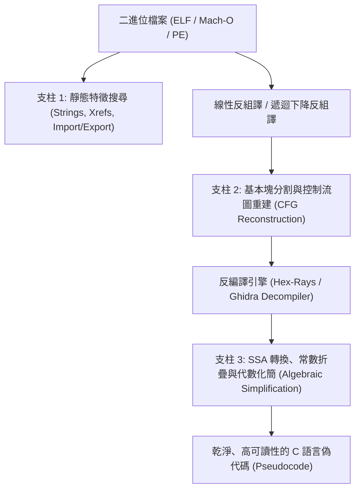
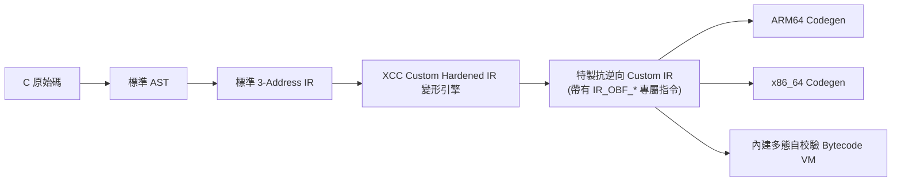
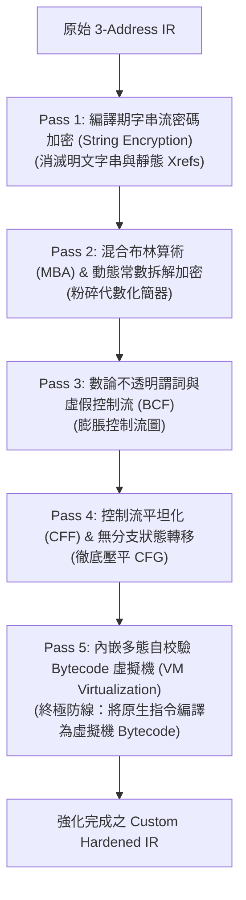

# 第 11 章：現代反組譯器的弱點與 Custom Hardened IR 設計

> 「知己知彼，百戰不殆。要打造堅不可摧的軟體防護盾，你必須先學會像頂尖逆向工程師一樣思考。」

在前面的章節中，我們從零打造了一個具備完整前端與跨平台原生後端（ARM64 / x86_64）的 C 編譯器。在標準編譯流程下，XCC 會產生乾淨、遵循架構規範的機器碼。

然而，當這套二進位執行檔被放進現代逆向工程工具——如 **IDA Pro**、**Ghidra**、**Binary Ninja**——之中時，它脆弱得如同一張白紙：
1. **字串交叉引用（String References）**：逆向人員只需按下快速鍵（如 IDA 的 `Shift + F12`），便能瞬間掃描出 `"Enter License Key:"` 或 `"Success! License Activated."`，並順藤摸瓜找到關鍵的驗證函式。
2. **控制流圖（Control Flow Graph, CFG）**：反組譯器的圖形視圖（Graph View）清晰呈現出每個 `if-else` 分支與迴圈塊，關鍵的破解跳躍點（如 `cmp` 接著 `jne`）一覽無遺。
3. **AST 級代數化簡（Algebraic Simplification）**：現代 Hex-Rays / Ghidra 反編譯引擎內建了極強大的常數折疊（Constant Folding）與死碼消除（Dead Code Elimination），一般的簡單混淆常在幾毫秒內被化簡還原為乾淨的 C 虛擬碼。

為了抵禦現代反組譯軟體的逆向分析，本篇將開啟全新的戰場：**特製強化中間表示（Custom Hardened IR）與多態虛擬機保護**。

在本章中，我們將剖析反組譯引擎的運作原理與阿基里斯之腱，探討為什麼在編譯器 IR 層實作防護最具威力和通用性，並介紹 XCC 專屬的防逆向指令集與多態 PRNG 隨機引擎。

---

## 11.1 現代反組譯器的工作原理與三大破解支柱

逆向工程師分析一個未知二進位檔時，主要依賴反組譯器（Disassembler）與反編譯器（Decompiler）的三大核心分析階段：



### 1. 支柱一：字串與靜態特徵（Strings & Cross-References）
反組譯器會掃描二進位檔的唯讀資料段（ELF 的 `.rodata`、Mach-O 的 `__cstring`、Windows PE 的 `.rdata`）。一旦找到以 null 結尾的可讀字串，反組譯器便會建立交叉引用（Xref），直接標記出「哪一行組合語言載入了這個字串」。這往往是破解者定位註冊碼比對函式的最快捷徑。

### 2. 支柱二：控制流圖重建（Control Flow Graph, CFG）
反組譯器以條件跳躍（`jne`, `cbz`, `b.eq`）為邊界，將指令流切割成一個個**基本塊（Basic Block, BB）**。接著，反組譯器透過支配樹（Dominator Tree）演算法辨識出結構化的 `if` 分支、`while` 迴圈與 `switch` 語法，將平坦的組合語言重新還原為結構分明的圖形視圖。

### 3. 支柱三：資料流分析與代數化簡（Data-Flow Analysis & Simplification）
反編譯器會將暫存器存取轉換為單一靜態賦值（Static Single Assignment, SSA）形式，並透過強大的模式比對規則（Pattern Matching Rules）化簡表達式：
* 若遇到 `x ^ 0`，化簡為 `x`。
* 若遇到 `(x + 5) - 5`，化簡為 `x`。
* 若遇到常數不變的條件跳躍（如 `if (2 > 1)`），直接剪枝消除非活躍分支。

---

## 11.2 為什麼在 IR 層打造 Custom Hardened IR 最具威力？

傳統的安全防護常採用「後處理加殼器（Packer）」或「組譯層混淆（Assembly Obfuscation）」。但這些做法存在顯著的缺點：
* **平台綁定**：針對 x86 PE 實作的加殼器，無法直接移植到 ARM64 macOS 或 Linux 上。
* **破壞現代安全機制**：加殼器常破壞 ASLR、代碼簽章（Code Signing，如 Apple Hardened Runtime）或觸發防毒軟體（AV/EDR）的啟發式誤報。
* **LLVM Pass 容易被特徵識別**：現存的開源混淆器（如 OLLVM、Hikari）大多基於 LLVM Pass，反逆向社群早已開發出大量的 Ghidra/IDA 腳本（如 D-OLLVM），能精準識別其特定的 IR Pattern 並自動去除混淆（Deobfuscation）。

### XCC 的 Custom IR 防護哲學
XCC 採取了完全原創的**原生 Custom IR 強化架構**：



1. **一次變形，全平台生效**：在平台無關的 IR 層進行混淆，變形完成後自然流入 ARM64 與 x86_64 代碼生成器，確保在 macOS、Linux、Windows 上產生一致且高強度的防護。
2. **私有指令語意（Proprietary Semantics）**：自定義的 IR 操作（如 `IR_OBF_MBA_ADD`、`IR_OBF_OPAQUE_TRUE`）不屬於標準 LLVM 體系，逆向分析工具無法利用既有的反 OLLVM 規則進行去混淆。
3. **無縫整合原生後端**：在代碼生成階段，一條特製的 Custom IR 指令可直接展開為交錯的硬體暫存器混淆指令，既保證了合法的記憶體與堆疊規範，又徹底粉碎了反組譯器的分析鏈。

---

## 11.3 XCC 專屬抗逆向指令集（Custom Obfuscated IR ISA）

在 [`include/xcc.h`](file:///Users/hcwtony/repo/projects/ccompiler/include/xcc.h#L474-L503) 中，我們為標準三址碼 IR 擴充了七大專為抗逆向設計的強化操作碼：

```c
typedef enum {
    // ... 標準 IR 操作碼 (IR_ADD, IR_LOAD, IR_JMP 等) ...

    /* ========================================================================
     * Custom Anti-Reversing / Hardened Obfuscated IR Instructions
     * ======================================================================== */
    IR_OBF_IMM,          /* dst = dynamic_reconstruct(imm=enc, obf_key, obf_rot) */
    IR_OBF_MBA_ADD,      /* dst = ((src1 ^ src2) + ((src1 & src2) << 1)) keyed with obf_key */
    IR_OBF_MBA_SUB,      /* dst = ((src1 & ~src2) - (~src1 & src2)) keyed with obf_key */
    IR_OBF_MBA_XOR,      /* dst = ((src1 | src2) + obf_key) - ((src1 & src2) + obf_key) */
    IR_OBF_OPAQUE_TRUE,  /* dst = ((((src1 ^ obf_key) * ((src1 ^ obf_key) + 1)) & 1) == 0) -> 1 */
    IR_OBF_OPAQUE_FALSE, /* dst = ((((src1 ^ obf_key) * ((src1 ^ obf_key) + 1)) & 1) != 0) -> 0 */
    IR_OBF_JUNK,         /* Anti-decompiler register/stack entropy perturbation */
} IROp;
```

每個強化 IR 指令結構體 `IRInst` 還擴充了多態混淆元資料：
```c
struct IRInst {
    // ... 標準欄位 (op, dst, src1, src2, imm, label, mem_size) ...

    uint64_t obf_key;        /* 多態動態金鑰 (由 PRNG 每次隨機產生) */
    uint64_t obf_rot;        /* 二次掩碼 (用於動態常數加密與位移混淆) */
    const char *obf_comment; /* 診斷註解 (在 --emit-ir 時顯示) */
};
```

---

## 11.4 高熵多態隨機引擎（SplitMix64 PRNG）

在密碼學與防逆向工程中，**多態性（Polymorphism）**是防禦特徵碼掃描（Signature-based Detection）的核心武器。若每次編譯產生的金鑰、混淆暫存器與分派狀態碼都一模一樣，破解者只要編寫一套靜態正則腳本就能批次解密。

為了實現「**每一次編譯、每一個二進位檔、每一個函式都擁有獨一無二的保護結構**」，在 [`src/ir_obf.c`](file:///Users/hcwtony/repo/projects/ccompiler/src/ir_obf.c#L10-L24) 中，我們實作了高熵且週期極長的 **SplitMix64** 偽隨機數生成器：

```c
static uint64_t splitmix64_next(uint64_t *state) {
    uint64_t z = (*state += 0x9E3779B97F4A7C15ULL);
    z = (z ^ (z >> 30)) * 0xBF58476D1CE4E5B9ULL;
    z = (z ^ (z >> 27)) * 0x94D049BB133111EBULL;
    return z ^ (z >> 31);
}

static uint64_t hash_str_seed(const char *s, uint64_t seed) {
    uint64_t h = seed ^ 0xCBF29CE484222325ULL;
    while (s && *s) {
        h ^= (uint64_t)(unsigned char)(*s++);
        h *= 0x100000001B3ULL; // FNV-1a 64-bit prime
    }
    return splitmix64_next(&h);
}
```

### 多態種子（Polymorphic Seed）傳遞機制
使用者可以透過命令列參數指定自定義種子：
```bash
./xcc --obf-all --obf-seed 0x13372026 my_app.c
```
若未指定，XCC 會自動選取高熵預設值。在進入每個函式混淆時，編譯器將全域種子與函式名稱（`fn->name`）透過 FNV-1a 雜湊結合，衍生出專屬於該函式的獨立 PRNG 狀態。這確保了同一個專案中的每個函式，其金鑰、不透明謂詞與狀態機均採用完全不同的隨機參數。

---

## 11.5 五大保護管線總覽（The Obfuscation Passes）

在 [`src/ir_obf.c`](file:///Users/hcwtony/repo/projects/ccompiler/src/ir_obf.c#L1400-L1458) 中，XCC 透過 `obfuscate_ir` 函式將五大防護技術有序編排：



每項防護都可以透過專屬的 CLI 參數獨立開啟或組合：
* `--obf-str`：僅啟用字串加密。
* `--obf-mba`：僅啟用混合布林算術與常數加密。
* `--obf-bcf`：僅啟用虛假控制流與不透明謂詞。
* `--obf-cff`：僅啟用控制流平坦化。
* `--obf-vm`：僅啟用 Bytecode 虛擬機虛擬化。
* `--obf-all`：啟用雙軌最高強度防護（全部 pass 同時生效！）。

---

## 11.6 小結

在本章中，我們掌握了：
1. 現代反組譯器（IDA Pro / Ghidra）的三大分析支柱：字串交叉引用、控制流圖重建、以及代數化簡引擎。
2. 為什麼在編譯器 IR 層實作反逆向保護，具有跨平台（ARM64/x86_64 通用）、高隱蔽性與架構解耦的絕佳優勢。
3. XCC 專屬的 7 條 Custom Hardened IR 強化指令與多態屬性。
4. 基於 SplitMix64 的高熵隨機引擎如何為每次編譯注入不可預測的多態防護。

在下一章中，我們將直接切入**數據流混淆（Data-Flow Obfuscation）**的第一道重拳：**混合布林算術（MBA）與動態常數拆解加密**！
