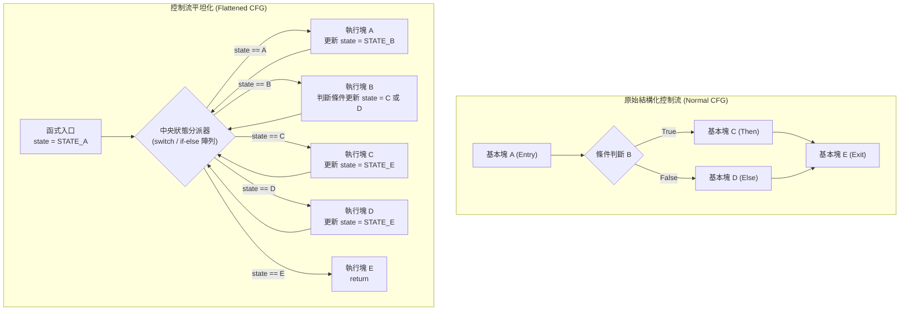

# 第 13 章：控制流平坦化（Control-Flow Flattening）與無分支狀態機

> 「正常的程式碼是一座層次分明的階梯；控制流平坦化，則是將階梯敲碎，全部扔進一個高速旋轉的離心機。」

在逆向工程中，**控制流圖（Control Flow Graph, CFG）**是分析人員理解軟體邏輯的骨架。無論是 IDA Pro、Ghidra 還是 Binary Ninja，它們最強大的功能之一就是圖形視圖（Graph View）：
* 綠色箭頭代表條件成立（`true`）的分支；
* 紅色箭頭代表條件不成立（`false`）的分支；
* 迴圈結構則表現為一條條清晰往回指向父節點的閉合環路。

逆向分析人員只要掃視這張結構圖，就能在幾秒內看出「這是一個 3 次重試的密碼驗證迴圈」或是「這是一個由多層 `if-else` 組成的權限檢查邏輯」。

為了徹底抹除程式碼的結構化特徵，**控制流平坦化（Control-Flow Flattening, CFF）**應運而生。
本章將深入剖析 XCC 如何在 [`src/ir_obf.c`](file:///Users/hcwtony/repo/projects/ccompiler/src/ir_obf.c) 中實作革命性的控制流平坦化引擎，並重點探討我們如何克服傳統 OLLVM CFF 的致命漏洞，引入**算術無分支狀態選擇（Branchless State Selection）**與**基本塊實體洗牌（Physical Block Shuffling）**。

---

## 13.1 傳統控制流平坦化的原理與盲點

控制流平坦化最初由匈牙利學者 László László 在 2001 年提出（後被著名混淆框架 OLLVM 廣泛採用）。其核心概念是將函式中的所有基本塊全部拆開，放到同一個層級，並由一個中央狀態機（Dispatcher Loop）統一調度。



### 傳統 OLLVM 平坦化的致命缺陷
傳統 OLLVM 在條件跳躍塊的末端，通常使用標準的條件分支來切換狀態變數：
```c
// 傳統 OLLVM 的狀態轉移
if (condition) {
    state = STATE_C;
} else {
    state = STATE_D;
}
goto dispatcher;
```
這種作法在面對現代反混淆工具（如 D-OLLVM、Triton、angr）時非常脆弱：
1. **符號執行（Symbolic Execution）精確切片**：分析腳本只要追蹤 `state` 變數的寫入點，就能輕易辨識出「這裡有一個條件分支決定 `state` 是 C 還是 D」。
2. **基本塊末端依舊存在條件跳躍指令**（`cmp` 接著 `jne`）：反編譯器仍然能辨識出基本塊內部的局部決策點。
3. **連續狀態碼暴露**：傳統實作常使用 `1, 2, 3, 4` 等連續整數作為狀態碼，逆向人員一眼就能看出順序。

---

## 13.2 XCC 的破局設計：算術無分支狀態選擇（Branchless State Selection）

為了徹底杜絕符號執行對狀態轉移分支的識別，XCC 在 [`src/ir_obf.c`](file:///Users/hcwtony/repo/projects/ccompiler/src/ir_obf.c#L610-L635) 中設計了一套**純算術／位元無分支狀態轉移演算法（Branchless State Transition）**！

### 數學原理推導
假設當前基本塊的條件運算式結果為布林值 $C \in \{0, 1\}$：
* 若 $C = 1$，下一狀態應為 $S_{\text{taken}}$；
* 若 $C = 0$，下一狀態應為 $S_{\text{fall}}$。

我們絕不發射任何 `if-else` 或條件跳躍指令，而是利用二補數（Two's Complement）的算術特性構造動態掩碼（Mask）：
$$M = -C = \begin{cases} 
\text{0xFFFFFFFFFFFFFFFF} & \text{若 } C = 1 \\
\text{0x0000000000000000} & \text{若 } C = 0 
\end{cases}$$

接著，取反掩碼：
$$\neg M = \begin{cases} 
\text{0x0000000000000000} & \text{若 } C = 1 \\
\text{0xFFFFFFFFFFFFFFFF} & \text{若 } C = 0 
\end{cases}$$

最後，透過位元運算與上一章學到的混合布林算術（MBA）合成下一狀態：
$$S_{\text{next}} = (S_{\text{taken}} \land M) \ \mathbf{MBA\_ADD} \ (S_{\text{fall}} \land \neg M)$$

* 當 $C = 1$ 時：$M = \text{全 1}$，$\neg M = \text{全 0}$，式子化簡為 $S_{\text{taken}} + 0 = S_{\text{taken}}$。
* 當 $C = 0$ 時：$M = \text{全 0}$，$\neg M = \text{全 1}$，式子化簡為 $0 + S_{\text{fall}} = S_{\text{fall}}$。

### 在 XCC 中的 IR 發射實作
在 [`src/ir_obf.c`](file:///Users/hcwtony/repo/projects/ccompiler/src/ir_obf.c#L616-L635) 中：
```c
// 1. 取得條件布林值 v_take_bit (0 或 1)
int v_is_zero = vec_emit_binop(&out, fn, IR_LOGNOT, term.src1, -1, 0);
int v_take_bit = (term.op == IR_JZ) ? v_is_zero : vec_emit_binop(&out, fn, IR_LOGNOT, v_is_zero, -1, 0);

// 2. 算術取負構造全 1 / 全 0 掩碼: v_mask = -v_take_bit
int v_mask  = vec_emit_binop(&out, fn, IR_NEG, v_take_bit, -1, 0);
int v_nmask = vec_emit_binop(&out, fn, IR_BITNOT, v_mask, -1, 0);

// 3. 透過動態常數加密載入兩個目標狀態碼
int v_st_t  = vec_emit_obf_imm(&out, fn, (int64_t)st_taken, rng, "branchless state (taken)");
int v_st_f  = vec_emit_obf_imm(&out, fn, (int64_t)st_fall, rng, "branchless state (fallthrough)");

// 4. 位元遮罩提取並透過帶金鑰 MBA_ADD 合併
int v_part1 = vec_emit_binop(&out, fn, IR_BITAND, v_st_t, v_mask, 0);
int v_part2 = vec_emit_binop(&out, fn, IR_BITAND, v_st_f, v_nmask, 0);
int v_next  = vec_emit_binop(&out, fn, IR_OBF_MBA_ADD, v_part1, v_part2, splitmix64_next(rng));

// 5. 寫回狀態變數並無條件跳回分派器！
vec_emit_store(&out, v_state_ptr, v_next, 8);
vec_emit_jmp(&out, dispatch_label, "branchless transition to CFF dispatcher");
```

**防護效果**：
在編譯出的機器碼中，**條件跳躍指令被徹底消滅**！每個基本塊的結尾清一色全都是位元運算與一條無條件的 `jmp .L_dispatch`。反編譯器完全找不到邊界分支條件，CFG 重建演算法被迫繳械！

---

## 13.3 隨機 32 位元高熵狀態碼與分派器掩碼加密

為了進一步打碎狀態分析，XCC 絕不使用連續狀態碼：
1. **隨機 32 位元高熵狀態碼**：
   在 [`src/ir_obf.c`](file:///Users/hcwtony/repo/projects/ccompiler/src/ir_obf.c#L485-L494) 中，每個基本塊被隨機賦予一個互不碰撞的 32 位元大整數（如 `0x51A8BC3F`、`0x1E4092D7`）。
2. **分派器全域動態掩碼（Dispatch Key Mask）**：
   在分派器比較時，XCC 引入動態掩碼 `dispatch_mask`：
   分派器不直接比較 `current_state == target_state`，而是計算：
   $$(\text{current\_state} \ \mathbf{MBA\_XOR} \ \text{dispatch\_mask}) == (\text{target\_state} \oplus \text{dispatch\_mask})$$
   這意味著記憶體中的狀態變數即使在執行期被動態傾印（Memory Dump），其值也與分派器的比較常數完全不同！

---

## 13.4 雙重 Fisher-Yates 實體洗牌（Physical Block Shuffling）

在許多初級混淆器中，雖然控制流被平坦化了，但基本塊在二進位檔案中的**實體排列順序（Physical Layout）**依然保持著原始程式碼的先後順序（Block 0 緊鄰 Block 1 緊鄰 Block 2）。逆向人員只要由上往下閱讀組合語言，依然能大致猜出執行脈絡。

XCC 在 [`src/ir_obf.c`](file:///Users/hcwtony/repo/projects/ccompiler/src/ir_obf.c#L524-L555) 中引入了**雙重 Fisher-Yates 洗牌演算法**：
1. **分派器比對順序洗牌（Dispatcher Permutation）**：
   分派器中檢查各個狀態的 `if` 序列被完全打亂。Block 0 不一定先被比對，可能先比對 Block 7，再比對 Block 2。
2. **基本塊實體輸出順序洗牌（Emission Permutation）**：
   在發射最終 IR 指令流時，基本塊在記憶體中的先後順序被徹底隨機重排！
   ```
   [Function Entry]
   [Flattened BB #4]
   [Flattened BB #1]
   [Flattened BB #7]
   [Dispatcher Loop]
   [Flattened BB #0]
   [Flattened BB #3]
   ...
   ```
原本照著線性順序執行的程式碼，現在在實體記憶體空間中如同天女散花。反組譯器若試圖以線性反組譯（Linear Sweep）閱讀，只會看到漫無目的的跳躍迷宮。

---

## 13.5 反編譯器視覺震撼對比

讓我們透過一個具體的例子，感受 `--obf-cff` 帶來的視覺衝擊。

編譯以下簡單的階乘計算程式：
```c
int factorial(int n) {
    int res = 1;
    while (n > 1) {
        res *= n;
        n--;
    }
    return res;
}
```

### 1. 未啟用混淆時的 CFG（IDA Pro Graph View）
* 結構清晰的循環圖形：入口塊 $\to$ 迴圈條件塊 $\to$ 迴圈本體塊（往回指）$\to$ 回傳塊。
* 總節點數：**4 個**。
* 反編譯偽代碼乾淨如初。

### 2. 啟用 `./xcc --obf-cff --obf-mba` 後的 CFG
* **「星狀輪輻（Star-Wheel / Hub-and-Spoke）形狀」**：
  所有基本塊呈圓環狀排列在四周，所有箭頭全部匯聚到正中央的巨大 Dispatcher 節點，然後從 Dispatcher 再發散出數十條放射狀的箭頭指向各個塊！
* **無條件跳躍覆蓋率：100%**。
* 每個塊內部沒有任何直觀的分支，只有 MBA 加密、位元掩碼計算、與無條件跳回中央分派器。

#### 反編譯器輸出的偽代碼（Ghidra 視角）：
```c
ulong factorial(ulong n) {
    ulong state;
    ulong mask;
    ulong res = 1;

    state = 0x6e2a1b94; // 加密初始狀態
    while (1) {
        // 龐大、無法被任何模式比對化簡的狀態分派器
        ulong masked_state = (state ^ 0x3f5c8a12) ...;
        if (masked_state == 0x51469186) {
            // Flattened BB #2
            res = ((res ^ n ^ ...) ...); // MBA 計算
            n = n - 1;
            // 算術無分支狀態轉移：
            mask = -(n > 1);
            state = (0x6e2a1b94 & mask) + (0x1f88c3a0 & ~mask);
            continue;
        }
        if (masked_state == 0x2098b114) {
            return res;
        }
        // ... 幾十行隨機排列的狀態比對
    }
}
```
原本 8 行的簡短函式，在反編譯器中瞬間膨脹為 **超過 150 行充滿魔術常數與無窮迴圈的代碼**！逆向人員想要還原出原本的 `while` 迴圈邏輯，需要耗費數小時手工標記狀態變數。

---

## 13.6 小結

在本章中，我們掌握了：
1. **控制流平坦化（CFF）的核心哲學**：破壞基本塊的巢狀結構，建立中央分派器輪輻架構。
2. **傳統 OLLVM 平坦化的死穴**：基本塊尾端的條件跳躍容易被符號執行精準切片。
3. **XCC 獨創的算術無分支狀態選擇**：利用 $-C$ 構造動態雙向掩碼，以 MBA 算術無條件計算下一狀態，徹底消除條件跳躍。
4. **雙重 Fisher-Yates 洗牌**：隨機重排分派器判定順序與基本塊實體排列順序。

此時，我們的防禦已經涵蓋了「數據流（MBA）」與「真實控制流（CFF）」。
但是，聰明的逆向分析者可能會問：**如果控制流圖裡出現的每一個基本塊都是真的，那我能不能只分析被執行的路徑？**

為了擊潰這種動態追蹤與路徑分析，在下一章中，我們將探討如何製造大量真假莫辨的迷魂陣：**第 14 章——數論不透明謂詞與虛假控制流（Bogus Control Flow）**！
