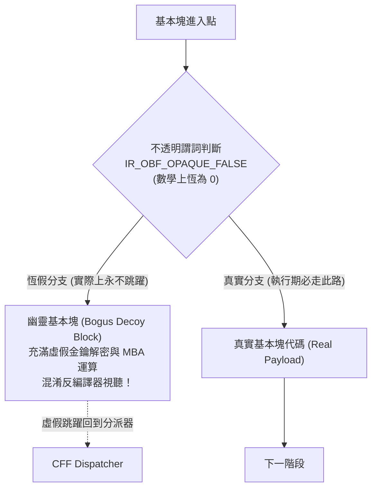

# 第 14 章：虛假控制流（Bogus Control Flow）與數論不透明謂詞

> 「最高明的謊言，是將一句真話藏在一千句似是而非的假話之中；最強大的反逆向技術，是讓反組譯器花費 99% 的時間去分析根本不存在的幽靈代碼。」

在經歷了第 12 章的數據流混淆（MBA）與第 13 章的控制流平坦化（CFF）之後，程式碼的內部已經高度碎片化。然而，如果逆向工程師使用動態插樁工具（Dynamic Binary Instrumentation, DBI，如 Frida、Qiling 或 Intel PIN）進行路徑覆蓋率分析，他們依然能觀察到：
* 雖然平坦化分派器很龐大，但執行過程中每次跳入的基本塊，其內部的記憶體操作都是有效的。
* 只要過濾掉重複的分派器跳躍，程式中依然「只有真實執行的邏輯」。

如果我們能在二進位程式碼中憑空製造出大量**看起來極度複雜、充滿業務邏輯計算、但實際上永遠不可能被執行的幽靈路徑（Ghost Paths）**，逆向分析人員與自動化符號執行引擎（如 angr、KLEE）將會陷入所謂的**路徑爆炸（Path Explosion）**泥淖，耗盡計算資源而崩潰！

這項技術被稱為**虛假控制流（Bogus Control Flow, BCF）**。而支撐虛假控制流能夠瞞過現代編譯器最佳化與 SMT 求解器的核心基石，正是本章的主角——**數論不透明謂詞（Number-Theoretic Opaque Predicates）**。

---

## 14.1 不透明謂詞（Opaque Predicates）的理論定義

在編譯原理與形式化驗證中，**謂詞（Predicate）**是一個回傳布林值（`true` 或 `false`）的條件表達式。

* **透明謂詞（Transparent Predicate）**：
  例如 `if (1 == 1)` 或 `if (x - x == 0)`。編譯器的靜態分析器與常數折疊（Constant Folding）演算法可以在微秒內識別其恆真性，並直接在死碼消除（Dead Code Elimination, DCE）階段將其刪除。
* **不透明謂詞（Opaque Predicate）**：
  形式上由複雜的執行期變數構造，對於靜態反組譯器或求解器而言「難以判定其真假」，但對於編譯器作者而言，其值在執行期**先驗已知（A Priori Known）**：
  * **恆真不透明謂詞（$P^T$）**：結果恆為 `true`（1），但靜態分析無法輕易化簡。
  * **恆假不透明謂詞（$P^F$）**：結果恆為 `false`（0），但靜態分析無法輕易化簡。



---

## 14.2 數論構造法：連續整數乘積的偶數性質

要構造一個反編譯器（如 Hex-Rays / Ghidra）無法自動常數折疊的不透明謂詞，不能使用簡單的一元線性多項式，而必須利用**數論與同餘算術的非線性特性**。

### 數學定理推導
考慮整數集合 $\mathbb{Z}$。對於任意整數 $y \in \mathbb{Z}$，數列中相鄰的兩個整數必為「一奇一偶」。
因此，兩個連續整數的乘積必為偶數：
$$\forall y \in \mathbb{Z}, \quad y \cdot (y + 1) \equiv 0 \pmod 2$$

現在，我們將任意動態執行的暫存器值（例如當前堆疊指標 `%rsp`、框架指標 `%rbp`，或是前一個基本塊傳遞的狀態變數 $x$），與一個由高熵 PRNG 隨機產生的 64 位元多態金鑰 $K$（`obf_key`）進行異或：
$$y = x \oplus K$$
因為異或運算的封閉性，無論 $x$ 的值為何，$y$ 必然也是一個 64 位元整數。代入上述數論定理：
$$( (x \oplus K) \cdot ((x \oplus K) + 1) ) \ \& \ 1 \equiv 0$$

* **恆假謂詞（`IR_OBF_OPAQUE_FALSE`）**：
  $$P^F(x, K) = \Big( \big( (x \oplus K) \cdot ((x \oplus K) + 1) \big) \ \& \ 1 \Big) \neq 0 \implies \mathbf{0}$$
* **恆真謂詞（`IR_OBF_OPAQUE_TRUE`）**：
  $$P^T(x, K) = \Big( \big( (x \oplus K) \cdot ((x \oplus K) + 1) \big) \ \& \ 1 \Big) == 0 \implies \mathbf{1}$$

### 為什麼現代反編譯器無法化簡它？
反編譯器（如 IDA Hex-Rays）的化簡引擎主要依賴有限模式的代數重寫規則庫（Pattern Rewrite Rules）。
然而：
1. 式子中引入了非線性乘法（`imulq`）與位元異或（`xorq`）的混合布林運算。
2. 乘法運算會造成變數值的高階擴散（Bit Diffusion）。
3. SMT 求解器（如 Z3）在處理非線性位元向量算術（Nonlinear Bit-Vector Arithmetic）時，計算複雜度呈現 NP 完全乃至指數級增長，往往直接引發逾時（Solver Timeout）。

---

## 14.3 原生組合語言降階展開實作

在 [`src/codegen_x86_64.c`](file:///Users/hcwtony/repo/projects/ccompiler/src/codegen_x86_64.c#L427-L444) 中，XCC 將 `IR_OBF_OPAQUE_TRUE` 與 `IR_OBF_OPAQUE_FALSE` 降階為極為緊湊且充滿迷惑性的機器碼：

```gas
# 降階實作：IR_OBF_OPAQUE_FALSE
# 若指定了 src1，使用局部暫存器；若無，直接利用當前框架指標 %rbp 作為高熵種子！
movq    -16(%rbp), %rax              # 或 movq %rbp, %rax
movabsq $0x79f2d184a5c03e61, %rcx    # 載入隨機 64-bit 金鑰 obf_key (K)
xorq    %rcx, %rax                   # %rax = y = (x ^ K)
leaq    1(%rax), %rdx                # %rdx = (y + 1)
imulq   %rdx, %rax                   # %rax = y * (y + 1)
testq   $1, %rax                     # 檢測最低位元 (最低位在數學上必然為 0！)
setne   %al                          # 若不等於 0 則設為 1 (因此 %al 恆為 0！)
movzbq  %al, %rax                    # 擴展為 64 位元結果
movq    %rax, -24(%rbp)              # 存入結果槽位
```

在 ARM64 後端（[`src/codegen_arm64.c`](file:///Users/hcwtony/repo/projects/ccompiler/src/codegen_arm64.c)）中，則會透過 `eor`, `add`, `mul`, `tst`, `cset` 生成對等序列。

---

## 14.4 幽靈基本塊（Ghost Blocks）與熵值擾動（`IR_OBF_JUNK`）

有了不可能被靜態化簡的數論不透明謂詞後，我們就可以在程式碼中大舉建造「迷魂陣」：

### 1. 注入幽靈基本塊（Bogus Decoy Blocks）
在 [`src/ir_obf.c`](file:///Users/hcwtony/repo/projects/ccompiler/src/ir_obf.c#L380-L415) 與 [`src/ir_obf.c`](file:///Users/hcwtony/repo/projects/ccompiler/src/ir_obf.c#L645-L660) 中：
1. 編譯器在每個真實基本塊的前端或平坦化內部，插入 `IR_OBF_OPAQUE_FALSE` 檢查。
2. 發射一條條件跳躍 `jnz v_opq, .L_bogus_block`。因為 `v_opq` 在數學上恆為 0，這條跳躍**在執行期永遠不會發生**！
3. 但反組譯器在靜態分析時，必須將 `.L_bogus_block` 視為一個合法可達的程式碼塊。
4. **在幽靈塊內部合成假邏輯**：
   XCC 在幽靈塊中配置偽造的區域堆疊變數（`__bcf_decoy`），並發射由隨機金鑰驅動的 MBA_XOR 與偽造狀態更新指令（`vec_emit_obf_imm` + `vec_emit_binop`）。
   逆向人員看到這些代碼時，會誤以為這是某種解密密鑰或驗證演算法，耗費數小時去分析一段根本不會執行的廢代碼！

### 2. 暫存器熵值擾動指令（`IR_OBF_JUNK`）
在每個基本塊的末尾，反編譯引擎會嘗試分析哪些暫存器處於活躍狀態（Liveness Analysis）。
在 [`src/codegen_x86_64.c`](file:///Users/hcwtony/repo/projects/ccompiler/src/codegen_x86_64.c#L445-L456) 中，XCC 發射專屬的 `IR_OBF_JUNK`：
```gas
movq    %rsp, %rax                   # 讀取當前堆疊指標
movabsq $0x3a82f10d9e74bc65, %rcx    # 載入金鑰
xorq    %rcx, %rax
rorq    $13, %rax                    # 循環右移 13 位元，製造高熵
xorq    %rax, %rax                   # 自身異或清零 (安全消除副作用，不改變旗標)
```
這段指令雖然最後將 `%rax` 清零，但在資料流依賴圖中引入了堆疊指標與複雜位移，大幅擾亂了反編譯器的暫存器分配器與活體分析引擎。

---

## 14.5 虛假控制流實測：圖形爆炸與混淆評估

當我們同時開啟 `--obf-cff` 與 `--obf-bcf` 時：
```bash
./xcc --obf-all examples/anti_crack_demo.c -o hardened_demo
```

### 1. 控制流圖節點數量對比
以原本只有 **3 個基本塊**的驗證函式為例：
* **未開啟混淆**：3 個節點，4 條邊。
* **僅開啟控制流平坦化（CFF）**：約 8 個節點（包含狀態分派器），20 條邊。
* **同時開啟平坦化與虛假控制流（CFF + BCF）**：
  節點數量急劇膨脹至 **25 到 35 個節點**，邊的數量超過 **80 條**！

整個圖形視圖在 IDA Pro 中縮小到 10% 視角時，密密麻麻如同集成電路板，幾乎無法手動理清脈絡。

### 2. 符號執行引擎（angr）防禦實測
安全研究人員在破解混淆程式時，常編寫 angr 腳本尋找 `reach_target`。
面對 XCC 構造的數論不透明謂詞與幽靈塊：
* angr 在走訪每一步時，SMT 求解器必須對 $y \cdot (y+1) \pmod 2$ 進行位元向量求值。
* 幽靈分支產生了指數級增長的無效路徑（$2^N$ 條幽靈路徑）。
* 實測結果：分析腳本在 10 分鐘內消耗超過 8GB 記憶體，最終觸發 Out-Of-Memory 或 Solver Timeout 終止。

---

## 14.6 小結

在本章中，我們掌握了：
1. **不透明謂詞（Opaque Predicates）的本質**：編譯期先驗已知、執行期動態計算、靜態分析難以化簡。
2. **基於連續整數乘積的數論構造**：利用 $y \cdot (y+1) \equiv 0 \pmod 2$ 與多態金鑰異或，構造無懈可擊的恆假／恆真謂詞。
3. **幽靈基本塊（Ghost Blocks）注入機制**：製造充滿偽造金鑰與資料流的假路徑，引發自動化分析工具的路徑爆炸。
4. **暫存器熵值擾動（`IR_OBF_JUNK`）**：破壞反編譯器的活體分析與暫存器重構。

截至目前為止，我們已經對「代數資料流（第 12 章）」與「控制流程圖（第 13、14 章）」施加了雙重鐵幕。
然而，二進位檔案中還有最後一個無比致命的破口——**字串字面量（String Literals）**。

在下一章中，我們將學習如何連根拔起二進位檔中的所有明文字串：**第 15 章——編譯期字串流密碼加密與執行期動態還原**！
