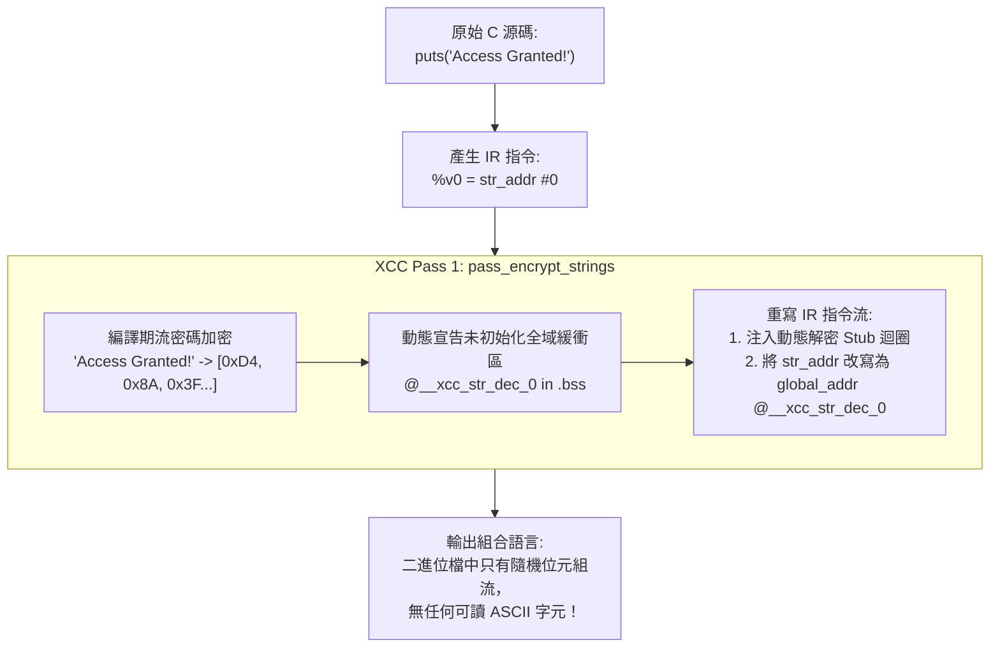

# 第 15 章：編譯期字串流密碼加密與執行期動態還原

> 「逆向工程有一句老生常談：『字串是二進位程式碼的靈魂之窗。』如果二進位檔裡連半個英文字母都看不到，逆向者的眼睛就等於被徹底蒙上。」

在軟體逆向工程的世界裡，最簡單、最無腦、卻往往最致命的第一步，就是使用命令列工具：
```bash
strings my_program | grep -E "(license|password|admin|flag|error)"
```
只要程式碼中寫了類似以下字句：
```c
if (strcmp(input, "SUPER_SECRET_KEY") == 0) {
    puts("Access Granted!");
} else {
    puts("Invalid Key, please contact admin@company.com");
}
```
這些字串常數在標準編譯流程下，會被毫不設防地明文寫入執行檔的常數段（Mach-O 的 `__TEXT,__cstring`、ELF 的 `.rodata`、Windows 的 `.rdata`）。
逆向人員只需在 IDA Pro 中按下 `Shift + F12` 打開字串視窗，對著 `"Access Granted!"` 按下 `X` 鍵查看交叉引用（Cross-Reference, Xref），就能瞬間定位到關鍵判斷指令，並直接在機械碼中把 `je` 改成 `jne` 完成破解！

本章將帶領讀者深入 XCC 的字串安全核心——在 [`src/ir_obf.c`](file:///Users/hcwtony/repo/projects/ccompiler/src/ir_obf.c#L180-L300) 中實作的**編譯期字串流密碼加密（Stream Cipher Encryption）與執行期動態還原機制**。我們將探討如何消除二進位檔中的靜態特徵，並斬斷反組譯器的所有靜態交叉引用（Xrefs）。

---

## 15.1 斬斷靜態分析的第一道防線

傳統開發者試圖隱藏字串時，常在 C 原始碼中手動編寫混淆：
```c
char key[] = { 'S'^0x55, 'U'^0x55, 'P'^0x55, 0 }; // 手工 XOR
```
這種土法煉鋼的方式有幾個致命缺點：
1. **大幅降低程式碼可維護性**：程式碼中充斥著難以閱讀的十六進位陣列，任何微小的字串改動都極易出錯。
2. **仍會留下模式特徵**：反組譯器反編譯出來後，依然會看到一段密集的賦值與異或迴圈。
3. **無法覆蓋全域指標與巨集**：例如 `printf("Status: %d\n", code)` 中的格式化字串依然是明文。

### XCC 的架構解法：編譯器自動化介入
在 XCC 中，開發者**完全不需要修改任何一行原始碼**，正常編寫標準的 `"My Secret String"`。
當開啟編譯選項 `--obf-str` 或 `--obf` 時：
1. 前端（Lexer/Parser）正常收集字串字面量並生成標準的 `IR_STR_ADDR` 指令。
2. 進入混淆器 Pass 1（[`src/ir_obf.c`](file:///Users/hcwtony/repo/projects/ccompiler/src/ir_obf.c#L228-L266)），編譯器在記憶體中自動掃描所有收集到的字串，並利用多態流密碼原地（In-Place）將文字加密成亂碼位元組流。
3. 將原本在 Mach-O `__cstring` 區段的屬性修改為 raw binary blob（`.byte 0x..`），防止被工具辨識為字串。
4. 在每個使用該字串的函式序言或調用點前，自動合成 IR 迴圈進行動態解密。



---

## 15.2 多態流密碼（Stream Cipher）演算法

如果對字串僅使用單一字元固定異或（例如每個 byte 都 `^ 0x55`），現代反惡意軟體引擎（如 Yara 規則）利用單位元組 XOR 爆破（Single-byte XOR Brute Force）可以在半秒內全部還原。

XCC 在 [`src/ir_obf.c`](file:///Users/hcwtony/repo/projects/ccompiler/src/ir_obf.c#L189-L193) 中設計了一個高擴散性的流密碼金鑰生成器：

```c
static uint8_t str_stream_key_byte(uint64_t enc_key, int index) {
    uint64_t mix = (enc_key >> ((index & 7) * 8)) + (uint64_t)index * 0x9E3779B9ULL;
    return (uint8_t)((mix ^ 0xA5ULL) & 0xFFULL);
}
```

### 演算法特點分析
1. **多態獨立金鑰（`enc_key`）**：
   每個字串字面量在編譯時，由 SplitMix64 PRNG 隨機分配一個專屬的 64 位元獨立金鑰 `enc_key = splitmix64_next(rng) | 1ULL`。同一個原始碼字串在不同的位置，其加密金鑰截然不同。
2. **位置相依性（Position-Dependent Key Stream）**：
   金鑰流的第 $i$ 個位元組結合了 `index` 與黃金比例常數 `0x9E3779B9ULL`。這意味著**即便原始字串中出現重複的字元（例如 `"AAAAAA"`），加密後的每一個位元組也完全不同**，徹底杜絕了頻率分析（Frequency Analysis）攻擊。
3. **無明文標記**：
   連字串結尾的空字元 `\0`（Null Terminator）也參與流密碼加密，使其在二進位檔中完全失去 C 字串特徵。

---

## 15.3 執行期動態解密 Stub 注入機制

在編譯期把字串加密成亂碼之後，程式在執行時該如何使用它？

如果我們呼叫外部解密函式（如 `decrypt_string(id)`），逆向人員只要在該函式下斷點（Hook），就能輕易截獲所有解密後的明文。

XCC 採取了最徹底的策略：**將解密邏輯完全內聯（Inlined）並降階為純粹的三址碼 IR 運算**！

在 [`src/ir_obf.c`](file:///Users/hcwtony/repo/projects/ccompiler/src/ir_obf.c#L194-L226) 中，`emit_decrypt_string_to_buf` 負責將解密邏輯直接編織進目標函式內部：

```c
static void emit_decrypt_string_to_buf(InstVec *v, IRFunc *fn, const StringLiteral *s,
                                       const char *buf_sym, bool use_mba, uint64_t *rng) {
    int v_src_base = alloc_vreg(fn);
    IRInst sa = make_inst(IR_STR_ADDR);
    sa.dst = v_src_base;
    sa.imm = s->id; // 指向只讀段中的密文 byte blob
    vec_push(v, sa);

    int v_dst_base = alloc_vreg(fn);
    IRInst ga = make_inst(IR_GLOBAL_ADDR);
    ga.dst = v_dst_base;
    ga.sym_name = buf_sym; // 指向位於可讀寫段 (.bss) 的解密緩衝區
    vec_push(v, ga);

    IROp add_op = use_mba ? IR_OBF_MBA_ADD : IR_ADD;
    IROp xor_op = use_mba ? IR_OBF_MBA_XOR : IR_BITXOR;

    for (int i = 0; i < s->len; i++) {
        int v_off = vec_emit_imm_auto(v, fn, i, use_mba, rng, NULL);
        int v_sp  = vec_emit_binop(v, fn, add_op, v_src_base, v_off, splitmix64_next(rng));
        int v_dp  = vec_emit_binop(v, fn, add_op, v_dst_base, v_off, splitmix64_next(rng));
        
        int v_enc_ch = vec_emit_load(v, fn, v_sp, 1, true); // 載入密文 1 byte
        uint8_t kb = str_stream_key_byte(s->enc_key, i);
        int v_kb = vec_emit_imm_auto(v, fn, (int64_t)kb, use_mba, rng, NULL);
        
        // 利用 MBA_XOR 還原明文字元！
        int v_dec_ch = vec_emit_binop(v, fn, xor_op, v_enc_ch, v_kb, splitmix64_next(rng));
        vec_emit_store(v, v_dp, v_dec_ch, 1);                // 存入解密緩衝區
    }
    // 寫入結尾 null terminator \0
    // ...
}
```

### 兩大精巧處理細節
1. **結合 MBA 與動態常數加密（`use_mba`）**：
   在解密迴圈中，位移計算 `v_sp = v_src_base + i` 使用 `IR_OBF_MBA_ADD`，金鑰異或使用 `IR_OBF_MBA_XOR`，每個字元的金鑰位元組 `kb` 則透過 `IR_OBF_IMM` 動態還原！這使得整個解密過程在反組譯器看來，就像是極度繁複的數學運算，完全看不出是在做字串解密。
2. **全域字串指標的開機即解密（`main` 函式序言預先解密）**：
   在 C 語言中，常有全域變數直接指向字串：`const char *g_banner = "Welcome";`。
   在 [`src/ir_obf.c`](file:///Users/hcwtony/repo/projects/ccompiler/src/ir_obf.c#L272-L279) 中，XCC 特別在 `main` 函式進入點自動注入所有字串的預解密 Stub，確保所有跨函式的全域字串指標在被存取前就已經處於就緒狀態。

---

## 15.4 組合語言段切換：徹底消滅 `__cstring` 與 `.rodata`

標準的組譯器在處理常數字串時，會自動放入作業系統專門用於存放 C 字串的段（Section）：
* macOS Mach-O：`.section __TEXT,__cstring,cstring_literals`
* Linux ELF：`.section .rodata`
* Windows PE：`.section .rdata,"dr"`

反組譯軟體在載入二進位檔時，會特別對這些段進行字元編碼掃描。

在 [`src/codegen_x86_64.c`](file:///Users/hcwtony/repo/projects/ccompiler/src/codegen_x86_64.c#L38-L78) 與 [`src/codegen_arm64.c`](file:///Users/hcwtony/repo/projects/ccompiler/src/codegen_arm64.c#L88-L125) 中，XCC 實作了專屬的段分類發射器：
```c
/* 1. String Literals (Plaintext vs Obfuscated Encrypted Byte Blobs) */
if (ir->strings) {
    bool has_plain = false, has_enc = false;
    for (const StringLiteral *s = ir->strings; s; s = s->next) {
        if (s->is_encrypted) has_enc = true;
        else has_plain = true;
    }
    // 若為加密字串，在 macOS 放入 __TEXT,__const，而非 __cstring！
    if (has_enc) {
        if (target->is_macos) {
            fprintf(out, "  .section __TEXT,__const\n");
        } else if (target->is_windows) {
            fprintf(out, "  .section .rdata,\"dr\"\n");
        } else {
            fprintf(out, "  .section .rodata\n");
        }
        for (const StringLiteral *s = ir->strings; s; s = s->next) {
            if (!s->is_encrypted) continue;
            fprintf(out, ".L.str.%d:\n", s->id);
            for (int i = 0; i <= s->len; i++) {
                unsigned char b = (i < s->len) ? (unsigned char)s->data[i] : 0;
                fprintf(out, "  .byte 0x%02x\n", b); // 以純十六進位位元組形式發射
            }
        }
    }
}
```

這個改動雖然微小，卻極為致命：
* 在 macOS 上，Mach-O 的 `__TEXT,__cstring` 區段在二進位檔中**完全消失**！
* 所有的密文被當成普通的常數二進位資料（`__const`）儲存，反組譯器絕不會將其標記為字串，`strings` 工具完全無法提取出任何有效英文字句。

---

## 15.5 實測驗證：消滅所有明文字串與 Xrefs

讓我們拿包含敏感字串的測試程式進行驗證：

```bash
# 1. 未混淆編譯
./xcc examples/anti_crack_demo.c -o demo_plain
strings demo_plain | grep -E "(FLAG|License|Correct)"
```
輸出結果：
```
[DEMO] License Check: Success! FLAG{XCC_compiler_hardened_2026}
[DEMO] Incorrect license key!
```
所有敏感旗標與驗證字句赤裸裸地暴露在終端機中。

```bash
# 2. 開啟字串流加密與全防護編譯
./xcc --obf-str --obf-mba examples/anti_crack_demo.c -o demo_hardened
strings demo_hardened | grep -E "(FLAG|License|Correct)"
```
**輸出完全為空！**

接著，我們將 `demo_hardened` 載入 IDA Pro：
1. 字串視窗（Strings Window）中，原本的提示字句完全蒸發。
2. 逆向人員無法透過搜尋關鍵字找到任何程式碼定位點。
3. 交叉引用列表（Xrefs）徹底中斷，逆向人員只能從幾千行平坦化的無分支狀態機中，以肉眼硬抗動態還原迴圈。

---

## 15.6 小結

在本章中，我們掌握了：
1. **為什麼字串是逆向工程的最快捷徑**：IDA Pro / Ghidra 的靜態交叉引用（Xrefs）機制。
2. **多態流密碼演算法**：結合 64 位元隨機金鑰與黃金比例常數，消滅重複字元的頻率特徵。
3. **內聯動態解密 Stub**：透過純粹的三址碼 IR（結合 MBA_ADD 與 MBA_XOR），在執行期將密文動態解密至 `.bss` 緩衝區。
4. **組合語言段分離**：將密文從 `__cstring` 轉移至 `__const`，挫敗自動化掃描工具。

至此，我們已經建構了堅不可摧的四重防護網：
* **字串層**：無任何明文字串（第 15 章）
* **數據層**：帶金鑰 MBA 與常數加密（第 12 章）
* **路徑層**：數論不透明謂詞與虛假控制流（第 14 章）
* **結構層**：無分支控制流平坦化與實體洗牌（第 13 章）

然而，在頂尖安全攻防中，這依然不是終點。
如果破解者具備足夠的耐性，使用動態除錯器（GDB / LLDB）逐步單步執行原生機器碼，原生指令集的語意（如 ARM64 的暫存器移動、x86 的比較）終究會暴露。

為了給二進位程式碼打造最後一道「絕對不可逆」的終極防禦，在下一章中，我們將登上全書的最高技術巔峰：
**第 16 章——終極防線：內嵌多態自校驗 Bytecode 虛擬機（`--obf-vm`）**！
