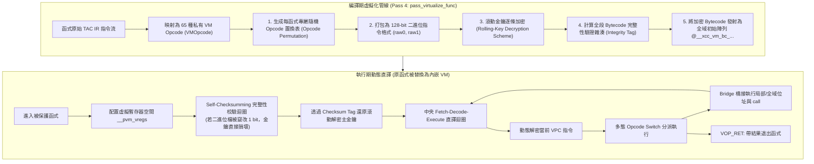

# 第 16 章：終極防線——內嵌多態自校驗 Bytecode 虛擬機（`--obf-vm`）

> 「當所有的程式碼都變成了虛擬機的資料，反組譯器眼中的世界就只剩下一個直譯迴圈與一片無法解讀的暗黑星雲。」

在軟體保護與數位版權管理（DRM）領域，以 **VMProtect** 與 **Themida** 為代表的「虛擬化保護技術（Code Virtualization）」被公認為二進位防護的終極天花板。

傳統的混淆手段（無論是 MBA、不透明謂詞、還是控制流平坦化），本質上依然是在**目標 CPU 的原生指令集（x86/ARM）**下進行變形。經驗老到的逆向人員只要花費足夠的精力，利用動態反組譯器逐步單步追蹤，依舊能夠看懂每一條指令的硬體執行語意。

而**虛擬化保護**則完全跳脫了硬體架構的維度：
它直接將函式原本的原生機器碼／三址碼 IR 抽離，編譯成一套**世界上沒有任何人見過、每次編譯都不相同的私有隨機字元碼指令集（Custom Bytecode ISA）**；接著，在原函式內部原地合成一個迷你的直譯器引擎（VM Interpreter）。當程式執行到該函式時，CPU 執行的不再是業務邏輯，而是在執行虛擬機直譯迴圈！

本章將深入剖析 XCC 最頂級的安全武庫——在 [`src/ir_obf.c`](file:///Users/hcwtony/repo/projects/ccompiler/src/ir_obf.c#L675-L1390) 中實作的**內嵌多態自校驗 Bytecode 虛擬機（Polymorphic Self-Checksumming VM Virtualizer，命令列參數 `--obf-vm`）**。

---

## 16.1 虛擬化保護架構全景

當我們對目標程式開啟 `--obf-vm` 時，XCC 會將函式進行徹底的結構重組：



---

## 16.2 私有指令集與 128-Bit Bytecode 編碼

在 [`src/ir_obf.c`](file:///Users/hcwtony/repo/projects/ccompiler/src/ir_obf.c#L678-L748) 中，我們定義了多達 65 種涵蓋算術、記憶體存取、型別轉換與控制流的虛擬操作碼 [`VMOpcode`](file:///Users/hcwtony/repo/projects/ccompiler/src/ir_obf.c#L678-L748)：
* 純量運算：`VOP_ADD`, `VOP_SUB`, `VOP_MUL`, `VOP_DIV32_S/U`, `VOP_XOR` ...
* 記憶體載入／寫入：`VOP_LOAD8_S/U`, `VOP_LOAD32`, `VOP_STORE64` ...
* 控制跳躍：`VOP_JMP`, `VOP_JZ`, `VOP_JNZ`, `VOP_RET`
* 原生橋接：`VOP_BRIDGE`（用於呼叫標準 C 函式或處理本地堆疊指標）

### 128 位元雙字元指令格式
每條虛擬指令在記憶體中剛好佔據 16 位元組（兩個 64 位元整數 `raw0` 與 `raw1`）：
* `raw0`（64 bits）：
  * bits 0..15：**隨機多態操作碼（Opcode）**
  * bits 16..31：目的虛擬暫存器編號（`dst`）
  * bits 32..47：來源暫存器 1 編號（`src1`）
  * bits 48..63：來源暫存器 2 編號（`src2`）
* `raw1`（64 bits）：
  * 存放 64 位元立即常數（`imm`）、或跳躍目標的 Bytecode PC。

---

## 16.3 多態指令集置換（Polymorphic Opcode Permutation）

如果一套虛擬機的 Opcode 是固定的（例如 `VOP_ADD = 1`、`VOP_SUB = 2`），逆向分析人員只要分析過一次，就能寫出通用的反編譯腳本將 Bytecode 還原為 C 代碼。

XCC 的設計關鍵在於：**多態指令集隨機置換（Opcode Permutation）**！

在 [`src/ir_obf.c`](file:///Users/hcwtony/repo/projects/ccompiler/src/ir_obf.c#L835-L845) 中：
```c
uint16_t op_perm[VOP_COUNT];
uint16_t salt = (uint16_t)((splitmix64_next(rng) & 0x7FF0ULL) | 0x0100ULL);
for (int i = 0; i < VOP_COUNT; i++) {
    op_perm[i] = (uint16_t)(salt + i * 7 + (int)(splitmix64_next(rng) & 3ULL));
}
// 執行 Fisher-Yates 隨機洗牌
for (int i = VOP_COUNT - 1; i > 0; i--) {
    int j = (int)(splitmix64_next(rng) % (uint64_t)(i + 1));
    uint16_t t = op_perm[i]; op_perm[i] = op_perm[j]; op_perm[j] = t;
}
```

* 每個函式在編譯時，65 個操作碼的二進位數值被完全隨機打亂重排。
* 在函式 A 裡，`ADD` 可能是 `0x3F21`；但在函式 B 裡，`ADD` 變成了 `0x10A8`。
* 逆向人員無法編寫任何通用的 Bytecode 解碼器，每一份編譯產物都是獨一無二的隨機密文。

---

## 16.4 滾動金鑰解密（Rolling-Key Decryption）

除了 Opcode 置換之外，整個 Bytecode 映像檔（Image）在靜態儲存時**全部經過逐條獨立的動態金鑰加密**。

在 [`src/ir_obf.c`](file:///Users/hcwtony/repo/projects/ccompiler/src/ir_obf.c#L936-L959) 中，對於第 $idx$ 條虛擬指令：
$$k_{0} = \text{key0\_base} \oplus (idx \times \text{step0})$$
$$k_{1} = \text{key1\_base} \oplus (idx \times \text{step1})$$
$$enc_0 = raw_0 \oplus k_0, \quad enc_1 = raw_1 \oplus k_1$$

在執行期直譯迴圈中，虛擬程式計數器 `vpc` 每前進一步，解密金鑰便隨著位移與步長自動滾動演化。即使破解者從記憶體中傾印出某一個時刻的解密指令，他也無法直接推導出其他指令的明文。

---

## 16.5 核心殺著：自校驗防竄改（Self-Checksumming Anti-Tamper）

傳統的二進位保護常加入防竄改檢查（Anti-Tamper Check）：
```c
if (calculate_crc32(code) != EXPECTED_CRC) {
    exit(1);
}
```
這種常規檢查在逆向人員眼裡極其脆弱：破解者只要在反組譯器中找到這條 `if` 判斷，直接把條件跳躍改為 `nop`，整個防竄改機制就瞬間瓦解。

XCC 採取了密碼學級的深層耦合設計：**自校驗完整性雜湊直接參與解密金鑰的推導！**

### 數學原理
1. **編譯期計算完整性雜湊（Integrity Tag）**：
   在發射 Bytecode 時，編譯器將全段加密字元碼所有 64 位元字進行異或累加：
   $$\text{Integrity Tag} = \bigoplus_{i=0}^{2 \times N - 1} \text{bytecode}[i]$$
2. **掩碼加密主金鑰**：
   編譯器不直接儲存 $\text{key0\_base}$，而是儲存：
   $$\text{masked\_key0} = \text{key0\_base} \oplus \text{Integrity Tag}$$
3. **執行期動態校驗與衍生**：
   在進入 VM 之前，合成的序言迴圈（[`src/ir_obf.c`](file:///Users/hcwtony/repo/projects/ccompiler/src/ir_obf.c#L1012-L1030)）會主動走訪整個 Bytecode 陣列，重新計算真實的 $\text{tag}_{\text{runtime}}$，並動態還原金鑰：
   $$\text{key0\_base} = \text{masked\_key0} \ \mathbf{MBA\_XOR} \ \text{tag}_{\text{runtime}}$$

### 為什麼這個防竄改絕對無法繞過？
* **無條件跳躍點（No Branch to Patch）**：程式碼中**根本不存在 `if (tampered) exit()` 這樣的檢查指令**！
* **雪崩式崩潰（Avalanche Crash）**：如果破解者試圖在 Bytecode 中修改哪怕 1 個 bit（例如把比較指令改成恆真），$\text{tag}_{\text{runtime}}$ 就會產生偏差。這個錯誤的 tag 會直接導致計算出的 $\text{key0\_base}$ 面目全非，後續解密出來的所有 Opcode 全部變成隨機垃圾，虛擬機在執行下一條指令時會自然觸發非法記憶體存取而崩潰！
* 破解者無法透過「打補丁（Patching）」繞過驗證，想要修改邏輯，必須徹底逆向整個校驗演算法並重新計算平衡碰撞，極大提高了破解難度。

---

## 16.6 原生函式橋接（Native Bridge）

純虛擬機面臨的最大實用挑戰是：當虛擬化程式碼需要呼叫外部 C 標準庫（如 `printf`、`malloc`），或是讀取函式本身的局部堆疊框位址時該怎麼辦？

XCC 設計了強大的 **`VOP_BRIDGE` 橋接機制**（[`src/ir_obf.c`](file:///Users/hcwtony/repo/projects/ccompiler/src/ir_obf.c#L1250-L1350)）：
* 在虛擬化分析時，將 `IR_LOCAL_ADDR`、`IR_GLOBAL_ADDR`、`IR_STR_ADDR` 與 `IR_CALL` 識別為「邊界指令」，分配一個專屬的 `bridge_id`。
* 函式內部的直譯器在遇到 `VOP_BRIDGE` 時，無縫跳出虛擬機核心，在原生的堆疊環境中精準執行指標計算或真實的硬體 ABI 函式呼叫，再將回傳結果寫回虛擬暫存器插槽（`__pvm_vregs`），隨後立即重返 VM 執行環境。

這使得 `--obf-vm` 不僅能保護簡單的數學計算，還能**完整相容包括指標算術、記憶體分配、終端輸出在內的所有複雜 C 語言語法**！

---

## 16.7 終極防線：雙軌疊加防護（`--obf-all`）

如果說 `--obf-vm` 已經將原始邏輯變成了隨機 Bytecode，那麼最極致的安全防禦是什麼？

答案是：**雙軌疊加防護（Dual-Track Protection）**！
當在命令列指定：
```bash
./xcc --obf-all examples/anti_crack_demo.c -o ultra_hardened_app
```

XCC 會觸發這套絕妙的二階連鎖反應：
1. **第一軌（Code Virtualization）**：
   目標函式的所有原始邏輯被抽離，編譯為隨機多態 Bytecode，函式本體被替換為內嵌 VM 直譯器。
2. **第二軌（Obfuscating the Interpreter Itself）**：
   編譯器隨後對**「剛剛合成出來的這個 VM 直譯器本身」**，全面套用第 12～15 章的所有保護：
   * 直譯器的分派迴圈被 **控制流平坦化（CFF）** 打碎；
   * 直譯器的金鑰計算被 **混合布林算術（MBA）** 覆蓋；
   * 直譯器內部注入大量 **數論不透明謂詞與虛假控制流（BCF）**；
   * 所有的提示字串被 **流密碼動態加密**。

**最終結果**：
逆向人員看到的是一個被平坦化、充滿 MBA 與不透明謂詞的超大型控制流迷宮；即使耗盡心力逆向出這個迷宮的結構，才絕望地發現這只是一個虛擬機直譯器，而真正的核心代碼還躺在加密且具備自校驗防竄改的 Bytecode 映像檔中！

---

## 16.8 小結

在本章中，我們掌握了：
1. **虛擬化保護（Code Virtualization）原理**：將原生指令編譯為自定義 Bytecode，以直譯器替代原生代碼。
2. **65 種私有 VMOpcode 與每函式獨立的 Fisher-Yates Opcode 隨機置換表**。
3. **逐條滾動金鑰加密（Rolling-Key Decryption）**。
4. **自校驗防竄改（Self-Checksumming）**：利用全段 Bytecode 雜湊參與金鑰推導，消滅補丁條件分支。
5. **原生橋接器（`VOP_BRIDGE`）**：實現與原生環境及外部 C 標準庫的無縫互動。
6. **雙軌疊加防護（`--obf-all`）**：打造「混淆後的虛擬機執行加密 Bytecode」的終極防禦。

至此，全書最硬核、最精華的技術章節——**第四篇：Custom Hardened IR 與反逆向保護（Ch 11 – Ch 16）**已全部大功告成！

在全書的最後一篇中，我們將回歸軟體工程的嚴謹本質：
**第五篇：測試驗證與未來演進（第 17 章）——跨平台自動化驗證、抗破解實測與自舉之路**！
